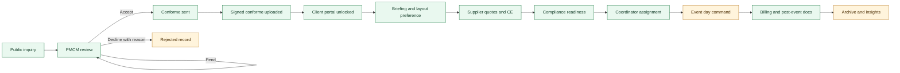
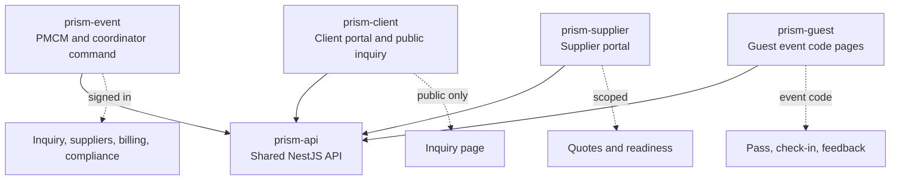
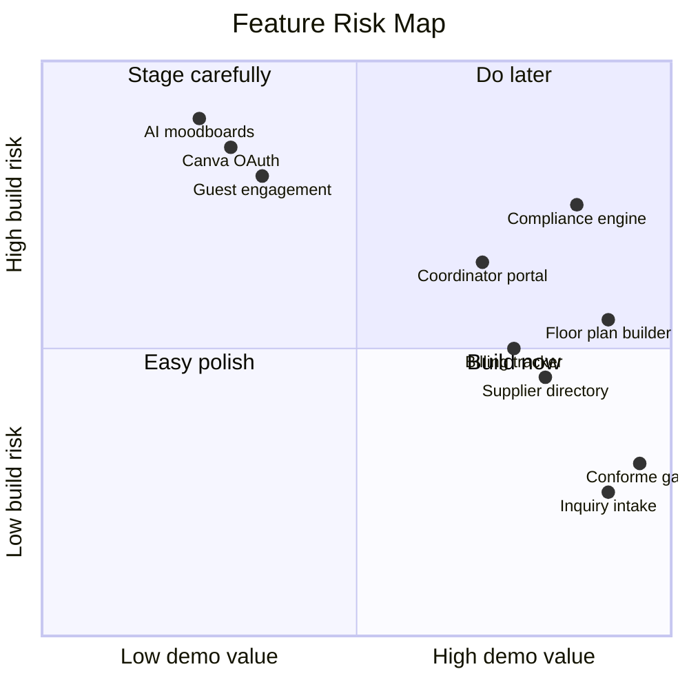
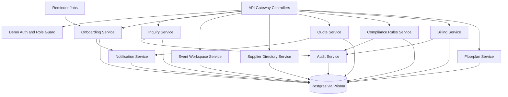
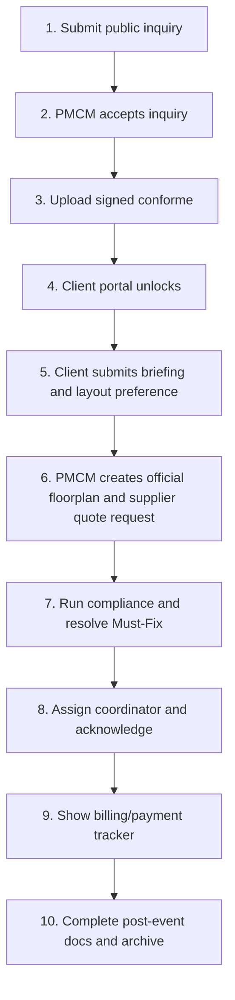

# P.R.I.S.M Feature Soundness Review

Date: 2026-04-28  
Scope: `prism-api`, `prism-client`, `prism-event`, `prism-supplier`, `prism-guest`, and the root product docs.

## Executive Verdict

P.R.I.S.M is directionally sound. The strongest product idea is not "an event app"; it is a gated PMCM operating system where every event passes through visible governance: inquiry, conforme, briefing, proposal, planning, event day, closure, and archive.

The main risk is scope width. The feature list is strong, but it describes a large operations platform. The codebase is currently strongest when it proves one complete lifecycle slice. For defense and Prism credibility, prioritize one polished event journey over adding more disconnected modules.

## Reviewed Sources

- Product docs: `../../AGENTS.md`, `../../README.md`, `../../docs/prism-v4/01-complete-feature-catalog.md`, `../../docs/prism-v4/07-implemented-feature-revisions.md`, `../../docs/prism-v4/08-revision-phase-plan.md`
- API: `../../prism-api/prisma/schema.prisma`, `../../prism-api/libs/modules/event-ops/src/event-ops.controller.ts`, `../../prism-api/libs/modules/event-ops/src/event-ops.service.ts`
- PMCM app: `../src/app/page.tsx`, `../src/lib/prism-api.ts`
- Client app: `../../prism-client/src/app/components/dashboard/Dashboard.tsx`, `../../prism-client/src/app/components/public-inquiry/PublicInquiryPage.tsx`
- Supplier app: `../../prism-supplier/src/app/page.tsx`, `../../prism-supplier/src/app/dashboard/page.tsx`
- Guest app: `../../prism-guest/src/app/open/page.tsx`, `../../prism-guest/src/app/dashboard/page.tsx`

## Status Legend

| Status | Meaning |
|---|---|
| Live | Backend and visible UI are connected enough for a demo. |
| Partial | Main model or UI exists, but behavior is incomplete. |
| Prototype | Mostly static, seeded, local-only, or mock-log behavior. |
| Planned | Present in docs, not implemented in the app yet. |

## Feature Maturity Heatmap

| Capability | Feature IDs | Current status | Soundness | Main gap |
|---|---:|---|---:|---|
| Public inquiry and intake log | 1, 46, 52, 53 | Live | 5/5 | Duplicate detection, previous rejection flag, and log-on-behalf are not complete. |
| Client onboarding and conforme gate | 2, 3, 26 | Live | 5/5 | Reminder job is in-process, invite open tracking is not real, and follow-up settings are not per event yet. |
| PMCM event command dashboard | 5 | Partial | 5/5 | Event-day live lanes, SLA timers, urgent issue logging, and status feeds are still shallow. |
| Client portal after conforme | 26, 28, 29, 34 | Partial | 5/5 | API is not role-guarded; client activity is mostly event filtering and local session state. |
| Floor plan builder and approval | 8, 80, 81, 82, 83, 84 | Partial to Live | 5/5 | Approval flow is simplified; table assignment rules are not tied to event type or guest count. |
| Supplier directory and tiering | 14, 15, 35, 79, New-S5 | Partial to Live | 5/5 | No supplier create/edit workflow, no review submission form, no certification upload, limited profile editing. |
| Supplier quote requests | 16, 17, 18, 43, 63, 64, 75, 76, 77 | Partial | 5/5 | PMCM can log/request quotes, but supplier portal does not complete the quote lifecycle. |
| Coordinator assignment | 13, 88, 89, 90, 91, New-C1 | Partial | 5/5 | No real coordinator roster, availability calendar, skills filter, or role-specific task data. |
| Compliance engine | 6, 7, New-SY3 | Prototype | 5/5 | Rules are hardcoded checks, not a configurable rules table by event type and phase. |
| Billing and payment tracker | 20, 21, 69, 92, 93, 94, New-P5 | Partial | 5/5 | Amounts and dates are hardcoded; billing is not linked to CE/proposal line items. |
| Post-event docs, archive, insights | 22, 23, New-P1, New-P2, New-SY1, New-SY2 | Partial | 4/5 | Archive is not gated by close indicators; insights and event comparison are not generated. |
| Notifications | 25, 55 | Prototype | 4/5 | Email and Viber are logged as mock notifications, not queued or sent. |
| Security and privacy | New-SEC1 to New-SEC4, 56 | Partial | 5/5 | Demo auth uses stored passwords and UI-level routing; no real RBAC guards, hashed credentials, or file validation. |
| Supplier portal | 35 to 38, New-SUP1 to New-SUP4 | Prototype | 4/5 | Landing and dashboard exist, but dashboard cards are static and not supplier-event scoped. |
| Guest portal | 39 to 42, 95, New-EX2, New-GU1 | Prototype | 3/5 | Guest code lookup works, but check-in, feedback, moderation, QR scanning, and masterlist updates are not implemented. |
| Public pages and visual system | External/Public | Live | 4/5 | Logo and palette are present; hard-coded legacy colors still exist in components. |

## What Is Sound

### 1. The lifecycle gates are correct

The core business rule is strong: event creation and portal access should be gated by accepted inquiry plus signed conforme. The API currently creates/unlocks an event through conforme upload, which matches the PMCM workflow better than generic event creation.

### 2. The portal split is correct

The current app boundary is sound:

Do not collapse this back into a single all-role client app. It makes the product harder to explain and weakens the PMCM operating-system story.

### 3. Supplier tiering is a strong Prism add-on

The supplier directory is a good feature because it directly supports quote requests, PMCM institutional memory, and faster event planning. The eight-category lookup table and BNI flag are the right foundation. Tier 1 auto-suggest plus Tier 2 backup is easy to explain in a defense.

### 4. The floor plan remains the best visual proof

The floor plan builder is still the strongest live visual feature. It should be presented as event-owned PMCM operations, with clients submitting preferences and reviewing official layouts.

### 5. Audit and notification logs are the right abstraction

Even if real sending is deferred, logging the intent is useful for Prism defense. It supports the ITIL/accountability argument and can later become a real notification queue.

## Main Product Risks

| Risk | Why it matters | Recommended fix |
|---|---|---|
| Too many features are presented as equally important | The feature list has platform-scale scope, but the Prism needs a defensible event journey. | Mark each feature as Defense, Phase 2, or Roadmap in one canonical table. |
| `event-ops.service.ts` owns too much behavior | Inquiry, onboarding, suppliers, compliance, billing, guest access, and seeding are in one large service. | Split into focused services: inquiry, onboarding, suppliers, event workspace, compliance, billing, notifications, demo seed. |
| API auth is not enforcing real roles | Portals route users by UI, but the API endpoints are broadly callable. | Add a demo auth guard and role metadata before adding more workflows. |
| Read endpoint mutates data | `state()` triggers seeding and reminder sweep. That is convenient, but it makes behavior surprising. | Move seeding to reset/setup and reminders to a dedicated job endpoint or task runner. |
| Hard-coded business rules | Billing amounts, payment dates, compliance checks, quote defaults, and some statuses are fixed values. | Move rules into config tables or scenario seed data. |
| Notifications are mock logs | Good for Prism, but not enough for real PMCM operations. | Keep mock logs for defense, then add notification job status: queued, sent, failed, acknowledged. |
| Root docs are stale in places | Some docs still mention old `prism-web` and old ports. | Update root docs so the panel sees the same app boundaries as the code. |
| Design tokens are not fully centralized | Components still contain raw colors and one-off palette choices. | Move all PMCM brand colors to tokens and replace hard-coded component colors. |

## Recommended Changes

### P0: Do before adding more features

| Change | Impact | Reason |
|---|---|---|
| Create one canonical feature-status document | High | Prevents scope drift and makes it clear what is live vs roadmap. |
| Update stale root docs | High | The docs still reference old `prism-web`; this can confuse setup and defense framing. |
| Add demo RBAC guards to API endpoints | High | Current portal separation is mostly UI-level. The API should enforce PMCM/client/supplier/guest boundaries. |
| Split `EventOpsService` into domain services | High | The service is becoming the platform bottleneck and will slow every new feature. |
| Centralize statuses and transition rules | High | Inquiry, event, floorplan, payment, coordinator, and supplier tiers should not be free strings everywhere. |
| Keep client floor plans as preferences only | High | PMCM must own official layouts; clients should not appear to manage official event plans. |
| Replace remaining hard-coded legacy colors | Medium | This finishes the design-system cleanup and removes visual inconsistency. |
| Make sidebars fixed and main panes scroll | Medium | Sidebar scrolling feels broken in command apps; only the active work area should scroll. |

### P1: Make the current Prism genuinely end-to-end

| Change | Capability improved | Reason |
|---|---|---|
| Add duplicate inquiry detection and previous-decline flag | Inquiry | These are explicitly in the feature list and easy to demonstrate. |
| Add supplier profile edit/create and review submission | Supplier directory | The directory should not only show seeded data. |
| Add actual supplier quote submission from `prism-supplier` | Supplier quotes | This makes supplier portal more than a static dashboard. |
| Add configurable compliance rules table | Compliance | Turns the hardcoded demo check into a real PMCM rule engine. |
| Link billing to CE/proposal line items | Billing | Avoids hardcoded billing and supports dispute/audit story. |
| Add close-event gates | Closure/archive | Archive should require deliverables, billing, logistics, issues, and feedback indicators. |
| Add scoped event endpoints instead of broad `/api/demo/state` | API | Reduces data leakage and makes real-time polling cheaper. |

### P2: Production hardening after defense

| Change | Capability improved | Reason |
|---|---|---|
| Replace mock auth with real auth/session provider | Security | Required before real users or sensitive event data. |
| Add file storage and MIME validation | Documents | Conforme, contracts, certifications, photos, and videos need actual upload handling. |
| Add SendGrid and Viber adapters behind a notification queue | Notifications | Keeps Prism logs while allowing real delivery later. |
| Add durable scheduled jobs | Reminders | In-process timers disappear on restart and do not scale. |
| Add append-only audit guarantees | Governance | Required for the ITIL/accountability claim to be more than a normal log table. |
| Add pagination, filters, and per-role data access | API | Needed once demo data becomes real operational data. |

## Suggested Target Architecture

## Feature-by-Feature Notes

### Inquiry Management

Sound: yes. This should stay in the Prism because every demo starts here. The new intake log, source filters, status actions, decline reason, and unreviewed badge match the requested workflow.

Improve next:
- Add duplicate detection by email plus approximate event date.
- Add previous rejection history flag.
- Add "Log on Behalf" from PMCM side.
- Add manual referral details and client type correction fields.
- Store inquiry source and client type from lookup tables, not free strings.

### Client Onboarding

Sound: yes. This is one of the strongest Change Enablement proof points because it shows a request becoming authorized work.

Improve next:
- Store follow-up interval per event or per inquiry settings table.
- Track portal invitation states from real email events later.
- Separate "conforme sent" from "accepted" if PMCM sometimes accepts before sending the document.
- Add a clear "blocked until conforme" state in both PMCM and client portals.

### Supplier Directory

Sound: yes. This is worth keeping because it gives PMCM memory across events and supports better supplier selection.

Improve next:
- Add supplier create/edit screens in `prism-event`.
- Add supplier application workflow from public supplier registration.
- Add internal supplier review form after event closure.
- Add category-specific review dimensions.
- Add certification upload metadata and file handling.
- Make tier promotion/demotion explicit with reason and audit log.
- Let quote request builder select Tier 1, Backup, or Pending First Event with clear warnings.

### Supplier Quotes

Sound: yes, but not complete enough yet. PMCM-side quote logging exists, but the supplier portal must eventually submit structured quotes into the same records.

Improve next:
- Create quote request records with supplier recipient, deadline, status, and category.
- Add supplier-side quote submit/revise screen.
- Add quote comparison table with price, inclusions, payment terms, and flags.
- Add "quote locked after selected" behavior.

### Floor Plan

Sound: yes. It is the best visual demo moment.

Improve next:
- Keep PMCM official editing in `prism-event`.
- Keep client editing limited to preference drafts.
- Add client approve/revision action to the official layout review.
- Save floorplan snapshots for every submitted version.
- Gate table assignment to private events under 200 pax.

### Compliance Engine

Sound: yes as a differentiator, but current implementation is more of a placeholder than an engine.

Improve next:
- Add `ops_compliance_rules` with phase, event type, severity, title, condition, and active flag.
- Generate compliance checks from rules and briefing values.
- Add PMCM override reason and audit entry.
- Add pre-event re-check 7 days before event.
- Show "All Clear", "Must-Fix", and "Watch Out" statuses in the dashboard.

### Coordinator Management

Sound: yes. It maps directly to PMCM pain around Viber coordination.

Improve next:
- Add coordinator roster with roles, skills, availability, and reliability notes.
- Use event date overlap for double-booking detection, not just open assignment status.
- Add acknowledgment reminder interval.
- Build role-specific task data instead of one generic coordinator view.
- Add Event Day System Operator actions: check-in, late/no-show, urgent issues, task reassignment.

### Billing and Payments

Sound: yes. Billing triggered by conforme is easy to explain and operationally important.

Improve next:
- Generate billing from approved CE/proposal totals.
- Move payment terms into configuration.
- Add partial payment recording.
- Add payment-at-risk calculation from due dates.
- Add dispute and waiver flows with reason.

### Archive and Insights

Sound: yes, but should come after closure gates.

Improve next:
- Add one-screen close with five indicators.
- Prevent archive unless close gates pass or PMCM overrides with reason.
- Generate Event Insights Card from supplier reviews, issues, billing, docs, and feedback.
- Add archive search by client, event type, venue, month, and supplier.

### Supplier Portal

Sound: yes, but currently mostly a preview.

Improve next:
- Replace static dashboard cards with API-backed quote requests.
- Add quote submission and assignment confirmation.
- Add readiness confirmation.
- Add event-day status buttons: Arrived, Set Up and Ready, Done and Leaving.
- Hide unrelated event/client data from supplier sessions.

### Guest Portal

Sound: useful, but should remain extended scope unless the core event lifecycle is done.

Improve next only after Prism:
- Add guest masterlist and check-in writes.
- Add QR scan support only if HTTPS/demo constraints are solved.
- Add post-event feedback submission.
- Add PMCM moderation queue.

### Security, Privacy, and Audit

Sound: mandatory for credibility.

Improve next:
- Hash passwords or clearly label all auth as demo-only.
- Add API role guards and request actor context.
- Add Data Privacy notice screen.
- Add file type and size validation before accepting uploaded metadata.
- Make audit logs append-only at the service layer first, then database layer later.

### Visual Design System

Sound: mostly aligned with PMCM branding now.

Improve next:
- Replace raw hex values in components with shared CSS tokens.
- Keep sidebars fixed and non-scrollable; only content panes scroll.
- Use one button radius and density standard across all portals.
- Keep status colors semantic and consistent: New blue, Accepted green, Pending yellow, Declined red.
- Avoid card nesting in dashboard sections; use full-width panels and repeated item cards.

## What I Would Not Build Yet

These are valuable, but they should not block the defense Prism:

| Feature | Reason to defer |
|---|---|
| AI theme and moodboard suggestions | High complexity and not needed to prove the PMCM operating model. |
| Full Canva OAuth and PowerPoint generation | External dependency risk. Manual PDF upload is enough for Prism. |
| Full Zoom integration | Use a placeholder meeting link first. |
| Full guest engagement/game builder | Real-time complexity; belongs after core lifecycle. |
| Cancellation and postponement workflows | Important edge cases, but not required for the main demo. |
| Bilingual notification templates | Useful polish, but not core to the workflow proof. |
| Advanced analytics/event comparison | Needs richer real closed-event data first. |

## Recommended Defense Demo Cut

Use supplier directory as a strong supporting view inside step 6. Use guest and supplier portals as roadmap/prototype previews unless their workflows are made API-backed before the demo.

## Best Next Build Order

| Order | Work item | Why first |
|---:|---|---|
| 1 | Update root docs and create a canonical status matrix | Removes setup and scope confusion. |
| 2 | Add API role guard and actor context | Prevents future portal features from leaking data. |
| 3 | Split event-ops service by domain | Keeps future feature work maintainable. |
| 4 | Finish inquiry duplicate/rejection/referral features | Small effort, high demo value. |
| 5 | Finish supplier directory CRUD and review form | Makes the new supplier feature operational, not only seeded. |
| 6 | Add supplier quote request and supplier-side submit flow | Connects `prism-event` and `prism-supplier` meaningfully. |
| 7 | Convert compliance checks to configurable rules | Makes the differentiator real. |
| 8 | Add close gates and Event Insights Card | Gives the lifecycle a clean ending. |

## Bottom Line

The feature set is sound if P.R.I.S.M is framed as PMCM's internal governed event lifecycle system. The best improvement is not adding more features. The best improvement is making the current lifecycle deeper, more enforceable, and easier to defend:

1. One canonical status matrix.
2. One complete inquiry-to-archive demo.
3. Real API boundaries and role guards.
4. Supplier directory plus quote flow tied together.
5. Compliance and close gates backed by configurable rules.
