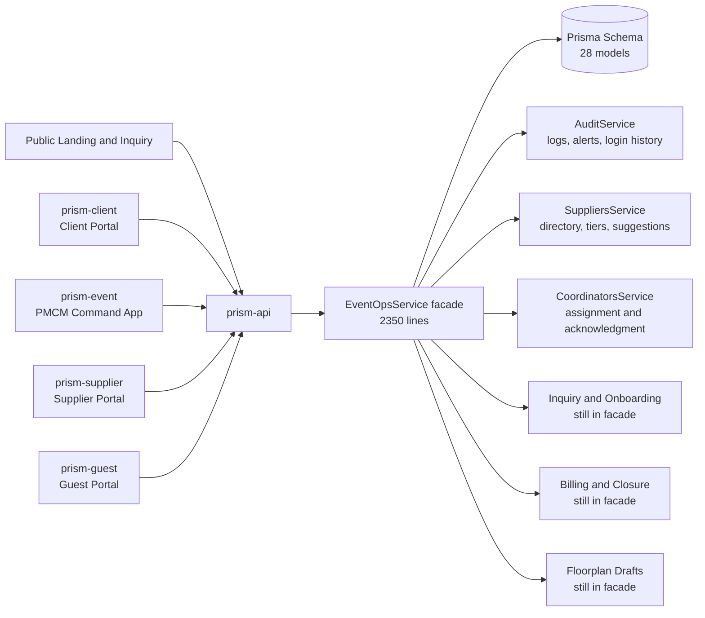
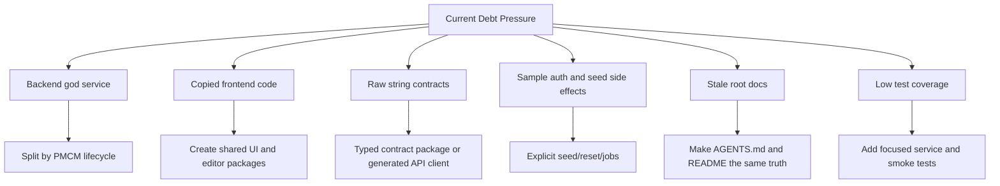
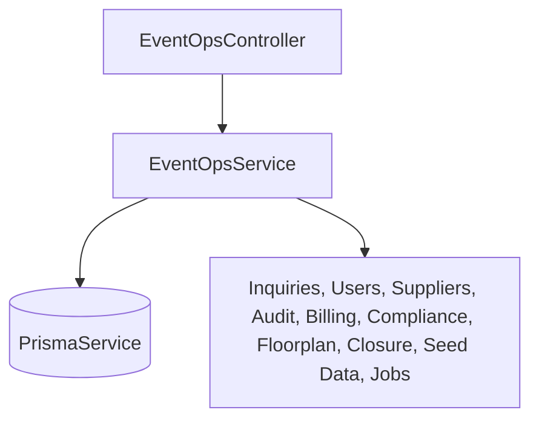
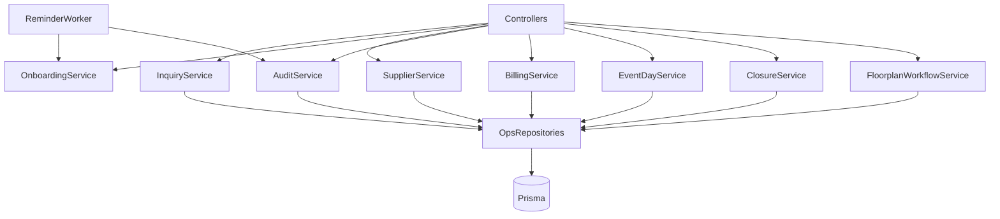
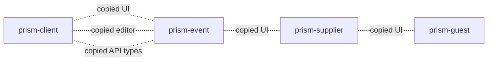
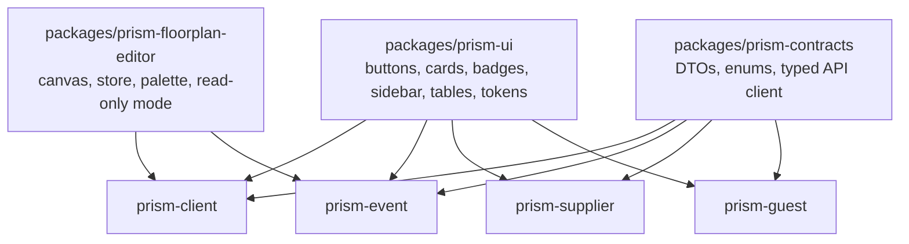

# P.R.I.S.M Maintainability and Tech Debt Audit

Date: 2026-04-28  
Updated: 2026-04-29 after the first maintainability sprint.

Scope: `prism-api`, `prism-client`, `prism-event`, `prism-supplier`, and `prism-guest`.

This audit focuses on accumulated tech debt that will make P.R.I.S.M harder to maintain as the PMCM workflow grows. It is based on source inspection, line-count hotspots, dependency counts, duplicated file checks, docs checks, and the current app boundary rules.

## Executive Verdict

P.R.I.S.M has the right product direction, but the implementation is still carrying debt in two places: the backend event-ops facade remains large, and multiple frontend apps are copying UI, theme, API, and editor code instead of sharing them intentionally.

The first hardening sprint reduced the most immediate risk: event-ops now has focused regression tests, audit/supplier/coordinator responsibilities have service seams, read-time seeding has been removed from normal state reads, and the largest PMCM panels have been extracted from `prism-event/src/app/page.tsx`.

The next maintainability move should continue the same pattern: extract inquiry/onboarding and billing/closure services, split the remaining PMCM page shell, then centralize shared UI/contracts/editor code across the role-specific portals.

## Visual Map





## Evidence Snapshot

| Area | Evidence | Maintainability Risk |
| --- | --- | --- |
| Backend hotspot | `prism-api/libs/modules/event-ops/src/event-ops.service.ts` is now 2,350 lines after extracting `AuditService`, `SuppliersService`, and `CoordinatorsService`. | Better than before, but the facade still owns inquiry, onboarding, billing, closure, compliance, floorplan workflow, seed/sample setup, and broad state aggregation. |
| PMCM frontend hotspot | `prism-event/src/app/page.tsx` is now 1,088 lines after extracting PMCM panels into `src/app/components/pmcm/`. | Better than before, but the page still owns admin approvals, inquiry intake, event tabs, floorplan tab rendering, billing/activity sections, and shell state. |
| Client frontend hotspot | `prism-client/src/app/components/dashboard/Dashboard.tsx` is 953 lines. | Client dashboard changes can accidentally affect unrelated dashboard behavior. |
| API client hotspot | `prism-client/src/lib/prism-api.ts` is 810 lines; `prism-event/src/lib/prism-api.ts` is 488 lines. | Frontend/backend contracts are duplicated manually. |
| Editor duplication | `Canvas.tsx`, `store.tsx`, and `RightPanel.tsx` are byte-identical between `prism-client` and `prism-event`. | Fixes to the editor must be remembered twice. |
| UI duplication | `button.tsx`, `card.tsx`, `sidebar.tsx`, `table.tsx`, `tabs.tsx`, `utils.ts`, and other UI files exist in all four frontend apps. | Styling drift is guaranteed unless these are shared or generated. |
| Dependency imbalance | `prism-client` has 58 runtime dependencies; each smaller portal has 7. | The original client shell still carries broad dependencies from earlier all-role work. |
| Schema breadth | Prisma schema has 28 models and API constants now exist for roles/statuses/tiers/action types. | Constants reduce string drift in touched API code, but values are not yet shared with frontend DTOs or enforced at DB level. |
| Docs drift | Root `README.md` and `CLAUDE.md` were refreshed locally, but the root folder is not a git repo. | The docs need a versioned home or copy/sync strategy, otherwise app repos cannot preserve root doc fixes. |
| Tests | `prism-api` now has Vitest and 4 event-ops test files covering 9 regression cases. | API lifecycle protection started, but frontend, shared editor, and other portal workflows still have no test foundation. |
| Sample state endpoint | `/api/sample/state` still exists for sample/reset compatibility, while PMCM and client app state now read scoped workspace endpoints. | Normal app surfaces no longer read the broad sample aggregate; keep it isolated to seed/demo compatibility until the sample harness can be removed. |
| Runtime jobs | `EventOpsService` starts a `setInterval` reminder loop in-process. | Background behavior depends on API process lifetime and is hard to observe. |
| Styling debt | Raw hex values still appear in page/components after theme work. | Legacy colors will keep leaking into new components. |
| Security debt | Sessions are stored in `localStorage` and sample users have plain seeded passwords. | Acceptable for Prism sample only; not a safe production baseline. |

## Sprint Progress Update

| Item | Status | Evidence | Remaining Risk |
| --- | --- | --- | --- |
| Add API test foundation | Done | `vitest.config.ts`, `test`, and `test:event-ops` scripts added in `prism-api`. | Coverage is still narrow and API-only. |
| Protect PMCM workflow behavior | Done for first slice | Tests cover inquiry accept/decline, conforme unlock, supplier suggestion/exclusion, coordinator conflict/acknowledgment, audit export alert, and reminder eligibility. | Add tests for billing, floorplan workflow, approval requests, and portal-specific UX. |
| Extract audit service | Done | `libs/modules/event-ops/src/services/audit.service.ts`. | Needs DB-level append-only enforcement later. |
| Extract supplier service | Done | `libs/modules/event-ops/src/services/suppliers.service.ts`. | Supplier DTO/contracts still copied into frontends. |
| Extract coordinator service | Done | `libs/modules/event-ops/src/services/coordinators.service.ts`. | Coordinator portal UI still needs focused tests. |
| Stop read-time seeding | Done for normal state/read paths | `state()` no longer calls `ensureSeeded()`; explicit `POST /api/sample/seed` exists. | Sample state remains only as a seed/demo compatibility aggregate. |
| Split PMCM panels | Partially done | `src/app/components/pmcm/` now contains audit, onboarding, supplier, coordinator, helper, and primitive components. | `page.tsx` is still 1,088 lines and should be split again. |
| Refresh root docs | Partially done | Local root `README.md` and `CLAUDE.md` were updated. | Root is not a git repo, so those edits are not preserved by child app commits. |

## Debt Heatmap

| Priority | Debt | Why It Matters | First Practical Fix |
| --- | --- | --- | --- |
| P0 | `EventOpsService` is still too large. | The first extraction helped, but the facade still owns too many lifecycle workflows. | Extract `InquiryService`, `OnboardingService`, `BillingService`, and `FloorplanWorkflowService` next. |
| P0 | Test coverage is only a thin API slice. | The most fragile PMCM rules now have tests, but UI behavior and other workflows can still regress. | Add focused tests for billing, floorplan submit/approve, approval requests, and frontend smoke flows. |
| P0 | `/api/sample/state` is still a broad compatibility aggregate. | Normal app state reads now use scoped workspace endpoints, but the compatibility endpoint remains broad enough to hide future coupling if new callers are added. | Keep compatibility isolated to API seed/demo paths and block new UI consumers from using it. |
| P1 | Duplicated editor code in client and event apps. | Official floorplan ownership belongs in `prism-event`, but shared editor internals are copied. | Extract editor engine/store/components to a shared package, then expose read-only client mode. |
| P1 | Duplicated shadcn-style UI across all portals. | Sidebar, buttons, cards, tables, badges, and tokens drift across portals. | Create `packages/prism-ui` or a synced component source with one owner. |
| P1 | API contracts are manually copied in each frontend. | A backend DTO change requires manual frontend updates. | Add `packages/prism-contracts` with shared DTO types and enums, or generate client types from OpenAPI. |
| P1 | Root docs have no versioned owner. | Local docs can be corrected but not committed if the root remains outside Git. | Put root docs in a versioned repo or move canonical boundary docs into each app repo with a sync rule. |
| P2 | `prism-client` dependency bloat. | More packages mean slower installs, harder upgrades, and more security surface. | Remove unused UI stacks after role split is stable. |
| P2 | Raw hex styling remains in components. | Brand/style cleanup becomes repetitive manual work. | Add lint/search gate for raw hex except in token files and canvas palettes. |
| P2 | In-process reminder timer. | Reminders are not durable and will not scale past local/sample usage. | Replace with a job table plus worker/cron runner. |

## Target Backend Shape

Current backend shape:



Recommended backend shape:



### Backend Module Boundaries

| Module | Owns | Should Not Own |
| --- | --- | --- |
| `inquiries` | public inquiry intake, accept/pend/decline, decline reason | portal session handling, supplier matching |
| `onboarding` | conforme sent/signed, portal invitation, reminder policy | billing milestones, supplier quotes |
| `suppliers` | categories, tiers, BNI flag, reviews, quote suggestions | inquiry status transitions |
| `audit` | append-only logs, alerts, login history, filters, export | feature business rules |
| `events` | accepted event shell, lifecycle stage, archive/reopen rules | raw floorplan object persistence |
| `floorplans` | official draft workflow, submit/approve/publish, editor persistence | client dashboard routing |
| `billing` | statements, milestones, payment status, reminders | supplier certification data |
| `coordinators` | assignment, acknowledgment, role views | global user auth |

## Target Frontend Shape

Current frontend shape:



Recommended frontend shape:



## Recommended Refactor Roadmap

### Phase 1: Stop The Bleeding

Goal: keep new features from increasing the same debt.

| Task | Owner Surface | Status | Definition of Done |
| --- | --- | --- | --- |
| Create shared status/role/tier constants. | API plus frontends | API started | API constants exist in `ops.constants.ts`; still need frontend/contract adoption. |
| Move seed/reset out of normal reads. | `prism-api` | Done for normal state reads | `/api/sample/state` no longer calls setup code; explicit sample seed route exists. |
| Add tests around new PMCM workflows. | `prism-api` | Done for first slice | Tests cover accept inquiry, decline reason, supplier suggestion by tier, pending exclusion, audit export alert, coordinator conflict/ack, conforme unlock, and reminder eligibility. |
| Split `prism-event/src/app/page.tsx`. | `prism-event` | Partially done | Page imports feature components for Suppliers, Audit, Onboarding, Coordinator Assignment, and Coordinator View. Inquiry intake and event detail sections still need extraction. |
| Make raw color usage visible. | Frontends | Not started | Add a documented allowed list: CSS token files and canvas drawing palettes only. |

### Phase 2: Extract Shared Surfaces

Goal: remove duplicated code that causes maintenance drift.

| Task | Owner Surface | Definition of Done |
| --- | --- | --- |
| Extract shared UI package. | Frontends | Four portals import `Button`, `Card`, `Badge`, `Table`, `Sidebar`, and token CSS from one place. |
| Extract floorplan editor package. | `prism-client`, `prism-event` | Editor internals live once; `prism-event` has edit mode and `prism-client` has read-only preference/review mode. |
| Extract API contract package. | API plus frontends | DTOs and enums are imported or generated; `prism-api.ts` files shrink to request wrappers and feature methods. |
| Reduce `prism-client` dependencies. | `prism-client` | Remove unused libraries from the old all-role shell after feature ownership moves out. |

### Phase 3: Production Hardening

Goal: make the Prism architecture survivable after sample.

| Task | Owner Surface | Definition of Done |
| --- | --- | --- |
| Replace sample auth storage. | API plus frontends | API receives actor identity through a guarded session flow; role checks are centralized. |
| Make audit tamper-resistant at DB level. | `prism-api` | Audit table has no app route for update/delete; DB trigger/RLS or policy blocks mutation outside append. |
| Replace in-process reminders. | `prism-api` | Reminder worker is a job runner with retry/log records, not `setInterval` inside the API service. |
| Add CI-style validation. | Root scripts plus app repos | One command runs API typecheck/build and frontend builds sequentially on Windows. |
| Add docs ownership. | Root docs | README, AGENTS, CLAUDE, Prism checklist, and feature review no longer contradict app boundaries. |

## Specific File-Level Findings

### 1. `event-ops.service.ts` Is Doing Too Much

File: `prism-api/libs/modules/event-ops/src/event-ops.service.ts`

Status update: this file is now 2,350 lines, down from 2,578, after extracting audit, supplier, and coordinator services. It is no longer the only owner of those workflows, but it is still too large for long-term maintenance.

Observed responsibilities in one service:

- login/session behavior
- seed data
- sample reset
- inquiry intake
- inquiry accept/pend/decline
- conforme reminders
- event creation
- supplier quotes
- compliance checks
- billing milestones
- closure/archive
- audit logs
- notification logs
- DTO mapping

Recommended change:

Continue extracting services one at a time. Do not rewrite all at once. The first least-coupled modules are done:

1. Done: `AuditService`
2. Done: `SuppliersService`
3. Done: `CoordinatorsService`
4. Next: `InquiryService`
5. Next: `OnboardingReminderService`
6. Next: `BillingService`
7. Next: `FloorplanWorkflowService`

This order keeps risk low because each extraction preserves the existing controller/API shape while shrinking the facade.

### 2. `/api/sample/state` Is Becoming A Dumping Ground

File: `prism-api/libs/modules/event-ops/src/controllers/sample.controller.ts`

The sample state endpoint still returns many models at once and maps them into one response. That was useful for prototype speed, but normal app surfaces should not depend on it.

Status update: normal reads no longer call `ensureSeeded()`, and the client/event app wrappers no longer expose broad sample-state reads. The remaining issue is keeping the compatibility endpoint from becoming a new UI dependency.

Recommended change:

Replace one broad state call with scoped reads:

| Current | Replacement |
| --- | --- |
| `/api/sample/state` | `/api/inquiries` |
| `/api/sample/state` | `/api/onboarding` |
| `/api/sample/state` | `/api/events/:id` |
| `/api/sample/state` | `/api/suppliers` |
| `/api/sample/state` | `/api/audit` |
| `/api/sample/state` | `/api/security-alerts` |

Keep `/api/sample/state` temporarily as a compatibility aggregator for seed/demo tests only.

### 3. UI Is Copied Across Portals

Repeated UI files exist in all four frontends:

- `button.tsx`
- `card.tsx`
- `badge.tsx`
- `sidebar.tsx`
- `table.tsx`
- `tabs.tsx`
- `sheet.tsx`
- `dropdown-menu.tsx`
- `scroll-area.tsx`
- `utils.ts`

Recommended change:

Create a shared component source:

```text
packages/
  prism-ui/
    src/
      components/
      tokens/
      cn.ts
  prism-contracts/
    src/
      inquiry.ts
      supplier.ts
      audit.ts
      event.ts
  prism-floorplan-editor/
    src/
      canvas/
      store/
      components/
```

If the repo stays as separate app repos for now, use a copied source generation script as an intermediate step. The key is that there must be one source of truth.

### 4. Sidebar Scroll Debt

The sidebar became scrollable because shared sidebar primitives are copied into every frontend and the navigation surface grew without a layout rule that separates:

- app shell height
- fixed header/footer regions
- nav list scroll region
- page content scroll region

Recommended change:

Make the shell contract explicit:

```text
viewport
  app shell: height 100dvh, overflow hidden
    sidebar: height 100dvh, overflow hidden
      brand/header: fixed height
      nav list: overflow-y auto only if needed
      user/footer: fixed height
    main: min-width 0, overflow-y auto
```

The sidebar itself should not scroll as a whole page. Only the nav list should scroll when items exceed available height.

### 5. Styling Tokens Are Not Enforced

Theme variables exist, but raw hex values still appear in pages and components. Some raw values are legitimate for canvas drawing palettes, but most layout and UI colors should use tokens.

Recommended change:

Create this rule:

- allowed raw hex files: `globals.css`, `theme.css`, editor canvas palettes, asset libraries
- disallowed raw hex files: app pages, dashboard components, sidebar, cards, tables, badges

Add a simple audit command to the docs:

```powershell
rg -n "bg-\[#|text-\[#|border-\[#|#[0-9A-Fa-f]{6}" prism-client prism-event prism-supplier prism-guest -g "*.tsx" -g "*.css"
```

### 6. Root Docs Need A Versioned Owner

Root `README.md` and `CLAUDE.md` have been refreshed locally to remove `prism-web` and port `3000`, while current product boundaries are:

| App | Role | Port |
| --- | --- | --- |
| `prism-client` | client portal | `3001` |
| `prism-supplier` | supplier portal | `3002` |
| `prism-guest` | guest portal | `3003` |
| `prism-event` | PMCM/admin/coordinator command app | `3004` |
| `prism-api` | shared NestJS API | `4000` |

Remaining issue:

`C:\Codes\prism` is not itself a git repository, so root doc edits are not preserved by commits in `prism-api`, `prism-event`, `prism-client`, `prism-supplier`, or `prism-guest`.

Recommended change:

Make `AGENTS.md` the source of truth and give root docs a versioned home. Either turn the root into a real repo/submodule workspace, or copy the canonical boundary docs into one app repo and sync them outward with a simple script.

### 7. Contracts Are Too Stringly Typed

Statuses, roles, tiers, source names, audit categories, and alert types appear as raw strings across backend and frontend code.

Status update: `prism-api/libs/modules/event-ops/src/ops.constants.ts` now defines canonical API values for roles, inquiry statuses, supplier tiers, coordinator assignment statuses, audit action types, audit categories, invitation statuses, notification channels, and login history statuses.

Recommended change:

Move from API-local constants to shared or generated contracts:

```ts
export const InquiryStatus = {
  New: "new",
  Accepted: "accepted",
  Pending: "pending",
  Declined: "declined",
} as const;

export type InquiryStatus = (typeof InquiryStatus)[keyof typeof InquiryStatus];
```

Then use the same values in API DTOs, frontend filters, badges, and database validation. The next step is a `packages/prism-contracts` package or generated API client so the frontends stop copying DTO/status values.

### 8. Test Coverage Needs A Thin But Real Foundation

The API now has a thin but real event-ops test foundation.

Current tests:

| File | Coverage |
| --- | --- |
| `event-ops.service.test.ts` | inquiry accept/decline, conforme upload/onboarding unlock, reminder eligibility |
| `services/audit.service.test.ts` | audit export threshold alert |
| `services/suppliers.service.test.ts` | Tier 1 auto-suggestion and pending-first-event exclusion |
| `services/coordinators.service.test.ts` | conflict detection and acknowledgment |

Recommended next tests:

| Test | Why |
| --- | --- |
| BNI toggle sets auto-trust behavior. | Protects supplier trust shortcut. |
| Billing milestone payment updates emit audit/notification records. | Protects finance workflow. |
| Floorplan draft submit/approve keeps official layout ownership in `prism-event`. | Protects the floorplan boundary. |
| Approval request approve/decline flow updates user/account state. | Protects PMCM admin account control. |
| Frontend smoke test for PMCM inquiry accept -> onboarding visible. | Protects the main event command happy path. |

## Suggested Maintainability Gates

Add these checks before large new features:

| Gate | Command or Rule |
| --- | --- |
| Backend build | `npm run build` in `prism-api` |
| Backend typecheck | `npm run typecheck` in `prism-api` |
| Frontend builds | `npm run build` in each frontend, sequentially on Windows |
| Raw color audit | `rg -n "bg-\[#|text-\[#|border-\[#|#[0-9A-Fa-f]{6}" ...` |
| Large file audit | Flag new/modified files above 500 lines unless they are generated or canvas-specific. |
| Contract drift audit | No new frontend DTO type that duplicates an API DTO without shared source. |
| Docs drift audit | Root README and app boundaries must match `AGENTS.md`. |

## What To Avoid

Do not do these yet:

| Avoid | Reason |
| --- | --- |
| Full backend rewrite | The current code works enough for Prism; incremental extraction is safer. |
| Moving all apps into one shell | The current product truth is role-specific portals. |
| Replacing Prisma | The problem is module ownership and contracts, not the ORM. |
| Adding a heavy design system library | The existing shadcn-style components are enough; they need central ownership. |
| Building more sample-only workflows on `/api/sample/state` | It increases migration cost every time. |

## Best Next Sprint

The previous "best next sprint" is now partially complete. The next sprint should do this:

1. Extract `InquiryService` and `OnboardingReminderService` from `EventOpsService`.
2. Extract billing/closure logic from `EventOpsService`.
3. Split the remaining `prism-event/src/app/page.tsx` sections: `InquiryIntakeLog`, admin approvals, event detail tabs, billing/activity.
4. Move API-local constants into shared frontend/API contracts or generate typed clients.
5. Add tests for billing, floorplan workflow, BNI auto-trust, and approval requests.
6. Start the shared UI/token package or source-sync script for the four portals.
7. Create a versioned owner for root docs and keep `AGENTS.md`, `README.md`, and `CLAUDE.md` aligned.
8. Document the allowed raw-color files and add the raw-color audit gate.

This sprint gives the highest maintainability return because it continues reducing backend conflict risk while starting the cross-portal duplication work that will otherwise keep causing styling and contract drift.
