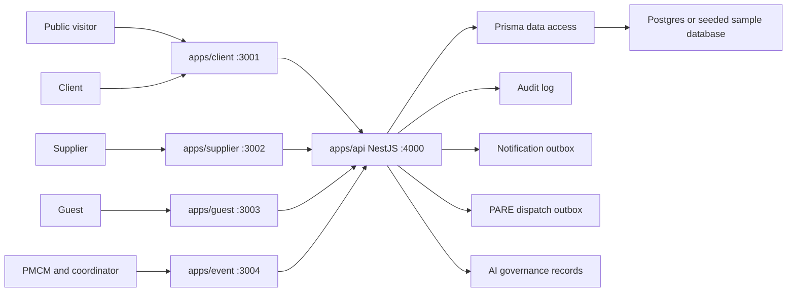

# P.R.I.S.M current architecture

This document is the canonical current architecture reference. Read it with
[`../constitution.md`](../constitution.md) for invariants, the
[`../product/actual-system.md`](../product/actual-system.md) for current product
behavior, and [`../product/future-state.md`](../product/future-state.md) for
target direction. Accepted architecture decisions are indexed in
[`decisions/`](decisions/).

## At a glance

- **Purpose:** Describe the implemented application, package, API, and backend context boundaries.
- **Authority:** Normative current architecture; accepted exceptions require an ADR.
- **Owner:** D (Anthony).
- **Scope:** Four role apps, shared packages, one NestJS API, Prisma, and compatibility surfaces.
- **Use when:** Locating ownership or deciding where a new route, contract, service, or query belongs.
- **Change when:** A runtime boundary, bounded-context owner, package contract, or compatibility rule changes.
- **Verify with:** Repository boundary checks, touched package checks, and API/portal verification.

The closeout command reads unresolved issues through the explicit pure public
`@prism/contexts/read-models/closeout` subpath, using its transaction client.
This avoids importing the read-model controller/module barrel back into lifecycle
commands. The exact subpath is registered in the boundary checker and
[context contracts](context-contracts.md); it does not permit arbitrary private
cross-context imports. Session-guarded controllers import the session and access
modules through their owning Nest composition roots. Built API HTTP acceptance
checks verify this runtime dependency graph as well as the route guards.
File-matrix and official snapshot reads use the similarly focused
`@prism/contexts/read-models/event-scope` seam for trusted inquiry and assignment
identity. Empty identities and inactive coordinator assignments/profiles confer
no event scope.

## Architecture principles

| Principle | Rule |
| --- | --- |
| One internal operating system | P.R.I.S.M serves PMCM's event lifecycle; it is not a public multi-tenant SaaS shell. |
| Role-specific apps | PMCM/coordinator, client, supplier, and guest experiences remain separate apps. |
| One shared API | `apps/api` remains one NestJS API and one Prisma client. |
| Scoped contracts first | New role surfaces use scoped APIs and shared types instead of broad sample-state reads. |
| Compatibility paths are temporary | `/api/sample/state` and reset/seed paths are for demo compatibility, not normal feature ownership. |
| PMCM owns official operations | PMCM owns official floorplans, supplier decisions, billing, compliance overrides, privacy operations, and audit review. |
| Portals are constrained views | Client, supplier, and guest portals see only role-safe event data. |
| High-risk dependencies are gated | Real storage, external auth, production notifications, QR/camera, and live AI require explicit approval, tests, and fallback behavior. |

## Runtime topology



## Application boundaries

| App | Port | Primary actors | Owns | Must not own |
| --- | ---: | --- | --- | --- |
| `apps/client` | 3001 | Public visitors and signed-in clients | Landing, inquiry, sign-in/sign-up, conforme-gated dashboard, client action center, client-visible billing/docs/floorplan status, layout preferences. | PMCM command center, official floorplan editing, supplier private reviews, PMCM costs, audit/privacy operations. |
| `apps/event` | 3004 | PMCM, admin, coordinator role views | Sign-in, command inbox, selected event workspace, official floorplans, supplier review/selection, billing, compliance, live ops, closure, privacy/audit review. | Public marketing, supplier self-service, guest public access, client-only dashboard ownership. |
| `apps/supplier` | 3002 | Suppliers and supplier applicants | Sign-in, assigned quotes, quote submission/revision, assignment confirmation, readiness, contract metadata, event-day status. | Other bids, PMCM private reviews, client data, internal PMCM costs. |
| `apps/guest` | 3003 | Guests and walk-ins | Access-code entry, event pass, consented check-in, walk-in flagging, moderated feedback. | Planning, client/supplier dashboards, PMCM internals, cross-event reads. |
| `apps/api` | 4000 | All apps through HTTP | Workflows, role scoping, sample auth, Prisma access, audit, notification outbox, AI governance, and `/sample/*` compatibility. | UI rendering, app-local session ownership, role-specific visual decisions. |

## Shared packages

| Package | Responsibility |
| --- | --- |
| `packages/types` | Shared Zod write schemas, inferred write types, read-model interfaces, session keys, and contract parsing. |
| `packages/api-client` | Shared request helpers and typed API-client functions for role apps. |
| `packages/floorplan-canvas` | Role-neutral editor state, canvas mechanics, and floorplan editor panels, injected with role-owned template storage. It does not read app identity or authorize, persist, or submit workflows. |
| `packages/ui` | Shared shells, brand, public blocks, and presentation primitives; no workflow ownership or role data rules. |
| `packages/tokens` | Shared design tokens, theme values, and typography. |

Event-ops contracts and API-client endpoints are organized into capability
modules behind the existing package-root exports. Portal consumers keep stable
imports while ownership and changes stay local to each capability.

Portal role apps import `@prism/floorplan-canvas` through their local floorplan editor wrappers. The client app chooses read-only mode for official layouts and keeps preference workflows; the event app retains PMCM official-plan authoring. Template API adapters stay in each portal.

## Portal data access and PMCM dashboard reads

Portal `lib/prism-api` modules are transport setup only: they construct the
shared API client with the role's stored bearer token and may expose thin URL or
request helpers. Feature HTTP calls belong in `features/**/data`, grouped by
their owning workflow or bounded context. A screen-level dashboard adapter may
compose those feature operations, but it must not depend on `Pick<typeof
prismApi>` or recreate an app-wide API facade. Authenticated actor identity is
derived from the verified session token; callers do not supply actor names or
role query parameters as identity evidence.

The initial PMCM home reads a compact summary and the paged command inbox. The
inbox queries seven actionable source streams with stable ordering, a page size
of ten per stream, and one extra row per stream to determine `hasMore`; exact
summary counts use aggregate queries. The selected-event workspace is fetched
when an event is selected. The broad PMCM dashboard read remains available to
secondary sections and loads only after navigation away from the home and inbox
sections. These bounds constrain records queried and returned; they do not claim
a measured latency improvement.

## Backend modular monolith

The backend is one NestJS modular monolith with one Prisma client. Its source tree
now follows the AlphaCI Enterprise composition pattern without copying AlphaCI's
business vocabulary:

```text
apps/api/src/
  modules/<bounded-context>/
    api/
    application/
    contracts/
    domain/             # only where a persistence-independent invariant exists
    infrastructure/     # only where an adapter exists
    <context>.module.ts
    index.ts
  kernel/<cross-cutting-concern>/
  compatibility/sample/
```

There is one API project in `apps/api/nest-cli.json`. The former collection of
small Nest library roots and per-library `tsconfig.lib.json` projects is no longer
the source layout. Public context aliases resolve `index.ts`; private folders are
not a supported cross-context API.

### Business contexts

| Context | Owns | Internal sub-areas |
| --- | --- | --- |
| `modules/event-lifecycle` | Inquiry/onboarding, compliance, closure, file requirements | `api/{onboarding,compliance,closure,files}`, matching `application/*` |
| `modules/commercial` | Supplier sourcing, quotes, billing | `api/{quotes,suppliers,billing}`, matching `application/*` |
| `modules/operations` | Staffing and guest workflows | `api/{staffing,guest}`, matching `application/*` |
| `modules/live-ops` | Event-day tasks, urgent issues, escalation, attendance/replacement, live status | `api`, `application`, `domain` |
| `modules/floorplan` | Official live floorplans and venue-template authoring/publishing | `api/{live,authoring}`, matching `application/*` |
| `modules/identity-access` | Authentication and account approval | `api/auth`, `application/auth` |
| `modules/platform-ops` | Trust/audit, notifications, AI governance | `api/*`, `application/*`, `contracts`, `infrastructure/*` |
| `modules/read-models` | Role-scoped cross-context read composition | `api`, `application/{mappers,queries,services}`, `contracts/ports`; no writes |

The merge decisions are ownership-based. `live-ops` stays separate from
`operations` because merging it creates a circular dependency through read
models. `platform-ops` remains a bounded context because its policies and
persistence are product-facing; it may be split later only after an explicit
ownership/deployment decision.

### Kernel and compatibility

```text
apps/api/src/kernel/
  access-control  database  event-core  event-session
  health          shared    shared-kernel

apps/api/src/compatibility/sample/
```

The kernel owns technical primitives: database access, event-core invariants and
command execution, verified session/auth primitives, access policy, health,
shared validation, and transaction helpers. `compatibility/sample` owns only
`/sample/*` demo/seed/reset behavior and may aggregate public context providers.
It is not the main data path for new role features.

### Boundary rules

```text
HTTP adapter -> application -> domain/contracts -> infrastructure ports
context -> another context's public index
context -> @prism/types serializable contract
context -> focused injected port/token
context -> kernel public index
read-models -> public readers/ports, read-only
```

`scripts/check-prism-boundaries.mjs` and the backend architecture checker enforce
the important rules: no private cross-context imports, no compatibility import
from normal contexts or kernel, no Prisma writes from read models, budgeted raw
read queries, and no tracked source under the old API library roots.

The kernel does not import a business context. `kernel/event-core` owns the
command-receipt port and Prisma adapter: transactional commands with an
actor- and event-scoped idempotency key and a stable payload hash opt into one durable
receipt, which is reserved and completed in the same transaction; retries then
replay the stored projected result after permission checks. A payload hash is
required so central replay cannot bypass a context's changed-content guard.
The receipt is a technical trust record; it does not replace an owning
context's domain record or its domain-specific invariant checks. Existing
commands without this explicit hash continue through their domain-specific
idempotency paths until migrated.
`kernel/access-control` emits
forbidden-access evidence through the kernel-owned `AUDIT_WRITER` port; the
composition root binds that port to the platform-ops `AuditWriterAdapter` in
`PlatformOpsAuditWriterModule`. Identity authentication, document storage,
notifications, and read-model composition use the same principle through
focused `AUTH_AUDIT`, `DOCUMENT_VAULT`, notification-writer, finance-command,
staffing-reader, floorplan-reader, and guest-reader seams. These are in-process
contracts today; they make extraction boundaries explicit without claiming
separate services or databases.

### Domain depth

`live-ops/domain` contains urgent-issue status and escalation policies;
`commercial/domain` contains quote-request lifecycle policies. They are pure and
unit-testable. Other contexts use progressive depth: add a domain policy only when
an invariant must hold independently of HTTP and Prisma.

## Data domains

| Domain | Representative models |
| --- | --- |
| Floorplans and venue templates | `FloorPlan`, `FloorPlanObject`, `VenueTemplate`, `PublishedSnapshot`, `OpsFloorPlanDraft` |
| Identity and access | `OpsUser`, `OpsApprovalRequest` |
| Core event lifecycle | `OpsInquiry`, `OpsEvent`, `OpsBriefing`, `OpsDocument` (inquiry/onboarding kinds), `OpsPostEventDocument`, `OpsEventInsight` |
| Supplier network | `OpsSupplier`, `OpsSupplierCategory`, `OpsSupplierReview`, `OpsSupplierReliabilityNote`, `OpsSupplierCertification`, `OpsSupplierQuoteRequest`, `OpsSupplierQuote` |
| Coordinator and live ops | `OpsCoordinator`, `OpsCoordinatorAssignment`, `OpsEventDayTask`, `OpsUrgentIssue`, `OpsEventDayLog`, `OpsCoordinatorReliabilityNote` |
| Compliance and billing | `OpsComplianceRule`, `OpsComplianceCheck`, `OpsBillingSource`, `OpsBillingStatement`, `OpsPaymentMilestone`, `OpsPaymentRecord` |
| Trust, privacy, and audit | `OpsPrivacyRequest`, `OpsAuditLog`, `OpsNotificationLog`, `OpsCommandReceipt`, `OpsLoginHistory`, `OpsSecurityAlert` |
| Guest operations | `OpsGuestCheckIn`, `OpsGuestFeedback` |
| AI governance | `OpsAiAuditLog`, `OpsAiApprovalRecord`, `OpsPareDispatch` |

The database remains one shared Postgres/Prisma boundary. Context ownership notes
and intentional read-join documentation are required before independent service
extraction; a source move alone does not imply database isolation.

Supplier withdrawal is a durable asynchronous boundary: `commercial` writes the
withdrawal and audit, then uses the public platform-ops dispatch-writer contract
inside the same `WorkflowCommandService` transaction to enqueue
`OpsPareDispatch`. The platform-ops worker claims rows with a lease token,
reloads the supplier request by ID, executes PARE without a database transaction
around the call, and settles success, bounded retry, or terminal failure. A
dispatch ID is stored on `OpsAiApprovalRecord` so a crash after approval creation
is safe to redeliver. The dispatch keeps an event FK for event-scoped cleanup but
does not own a commercial request FK; a missing or no-longer-withdrawn request is
a terminal worker outcome. Execution is bounded below the lease duration, aborts
provider calls on timeout, and tracks active executions through shutdown. Approval
recovery validates the sanitized request ID and dispatch ownership, while the
worker restores the idempotent `pare_triggered` activity audit.

## Lifecycle architecture

| Lifecycle step | Primary app | API ownership | Required boundary |
| --- | --- | --- | --- |
| Public inquiry | `apps/client` | `event-lifecycle` onboarding | Public submitters cannot set PMCM-only fields. |
| Inquiry review | `apps/event` | `event-lifecycle` plus `read-models` | PMCM owns accept, pend, decline, duplicate/referral review, and log-on-behalf metadata. |
| Conforme gate | `apps/event`, `apps/client` | `event-lifecycle`, identity/access, documents | Client dashboard and event creation require accepted inquiry plus signed conforme. |
| Briefing and proposal | `apps/event`, limited `apps/client` view | `commercial` and `event-lifecycle` | PMCM prepares; client sees approved/client-safe artifacts only. |
| Planning | `apps/event`, `apps/client`, `apps/supplier` | `floorplan`, `commercial`, `event-lifecycle`, `read-models` | PMCM owns official records; portals receive scoped views. |
| Event day | `apps/event`, `apps/supplier`, `apps/guest` | `live-ops`, `operations`, `read-models` | Role-safe run data only. |
| Closure/archive | `apps/event`, limited `apps/client` view | `event-lifecycle`, `read-models` | Archive is blocked unless gates pass or PMCM records an override reason. |

## Role-boundary matrix

| Data or action | PMCM/event app | Client portal | Supplier portal | Guest portal |
| --- | --- | --- | --- | --- |
| Public inquiry submit | Review and decision | Submit only | Not applicable | Not applicable |
| Accepted inquiry/conforme status | Full operational status | Own event status only | Not applicable | Not applicable |
| Official floorplan | Create, edit, submit, approve, lock | Read-only review plus preference/comment actions | Event-day logistics if assigned | Not visible |
| Supplier quotes | Create, compare, select, close | Approved proposal output only | Own request and submission | Not visible |
| Supplier private review/reliability | Full PMCM access | Not visible | Not visible | Not visible |
| Billing records | Full PMCM billing operations | Statements, milestones, receipts, client actions only | Contract metadata only where allowed | Not visible |
| Live ops | Full PMCM/coordinator-safe views | Client-safe status if exposed | Own assignment/status | Check-in/pass only |
| Audit and privacy | PMCM-only | Own request path if exposed | Own request path if exposed | Consent and own feedback only |
| AI suggestions | PMCM approval required | No autonomous action | No autonomous action | No autonomous action |

## State and session rules

1. Browser session and sample storage key names belong in `@prism/types`.
2. Role apps use shared helpers instead of adding literal `prism:*` keys.
3. API-backed sample auth/RBAC is acceptable for the current pass.
4. External auth is gated until provider, session migration, tests, and fallback
   behavior are approved.
5. Local sample state is allowed for seed/demo/reset compatibility only.

## Integration and adapter boundaries

| Integration | Current status |
| --- | --- |
| Database | Prisma-backed Postgres exists; schema separation and audit scripts are maintained. Live audits require the migrated target and credentials. |
| File storage | Metadata and file requirements exist; real storage, signed URLs, progress, retry, and adapter tests remain gated. |
| Notifications | Outbox, retry, and acknowledgement model exists; production providers remain gated. |
| AI | Sanitization, audit, approval, and PARE governance foundation exists; live calls/autonomous actions remain gated. |
| QR/camera | Guest access-code path exists; QR/camera scanning remains gated by HTTPS/device/masterlist constraints. |

## Architecture verification

| Check | Command/evidence |
| --- | --- |
| App/package boundaries | `npm run check:boundaries` |
| Root type safety | `npm run typecheck` |
| Root build | `npm run build` |
| API typecheck/build | `npm --workspace prism-api run typecheck` / `npm --workspace prism-api run build` |
| API tests | `npm --workspace prism-api run test` |
| API sample compatibility tests | `npm --workspace prism-api run test:sample-compatibility` |
| Prisma schema | `npm --workspace prism-api run prisma:validate` |
| Backend architecture boundaries | `npm run check:boundaries` plus the backend architecture boundary audit |
| UI smoke | `npm run smoke:ui` when the stack is available |
| Documentation consistency | `git diff --check` plus architecture/index updates |

## Architecture stop rules

Stop and update the plan if a change would:

1. Move PMCM command ownership into `apps/client`.
2. Let client, supplier, guest, or coordinator actors read PMCM-only records.
3. Treat `/api/sample/state` as the main path for a new role feature.
4. Add an app-local literal `prism:*` session key.
5. Ship real storage, production notifications, external auth, QR/camera, or
   live AI without required gate evidence.
6. Put workflow ownership inside `packages/ui`.
7. Claim completion without route, actor, contract, failure-state, and
   permission-boundary evidence.
