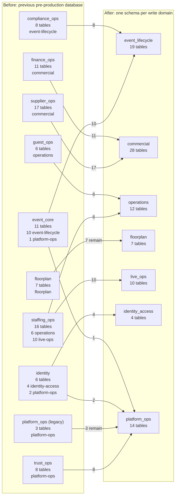

# P.R.I.S.M domain schema map

## At a glance

The previous pre-production database layout has ten application schemas for 93
business tables. Some schemas mix owners and include cross-domain foreign keys.
The new baseline creates the final 94-table schema from the Prisma model,
including the client floorplan grant. Same-domain foreign keys remain; all
cross-domain identifiers are scalar references checked through owner
capabilities when a command needs live state.

The target remains one PostgreSQL database, one Prisma client, and one API
deployment. Schema ownership is not a service boundary or a database
authorization boundary. `public._prisma_migrations` is excluded from the
business-table counts below.

## Before: previous pre-production namespace

The labels show physical schema, total table count, and owner split. Arrows
show where each owner slice belongs in the target. Mixed legacy schemas split
across owner schemas.

| Current physical schema | Tables | Owning domain(s) |
| --- | ---: | --- |
| `compliance_ops` | 8 | event-lifecycle |
| `event_core` | 11 | event-lifecycle (10), platform-ops (1) |
| `finance_ops` | 11 | commercial |
| `floorplan` | 7 | floorplan |
| `guest_ops` | 6 | operations |
| `identity` | 6 | identity-access (4), platform-ops (2) |
| `platform_ops` | 3 | platform-ops |
| `staffing_ops` | 16 | operations (6), live-ops (10) |
| `supplier_ops` | 17 | commercial |
| `trust_ops` | 8 | platform-ops |
| **Total** | **93** | **7 write domains** |

## After: target owner schemas

The baseline creates all 94 tables in their owner schemas, including the
floorplan-access grant. The target assigns 83 of the 93 legacy tables to a
different owner schema; ten already used their target schema name. This clean
baseline copies no existing rows.
The old history recorded 45 cross-domain foreign-key behaviors; the baseline
does not recreate those constraints. Its 76 foreign keys are same-domain, and
the target Prisma schema contains no cross-domain relation.

| Write domain | Target schema | Tables | Columns |
| --- | --- | ---: | ---: |
| event-lifecycle | `event_lifecycle` | 19 | 290 |
| commercial | `commercial` | 28 | 319 |
| operations | `operations` | 12 | 142 |
| live-ops | `live_ops` | 10 | 122 |
| floorplan | `floorplan` | 7 | 75 |
| identity-access | `identity_access` | 4 | 42 |
| platform-ops | `platform_ops` | 14 | 201 |
| **Total** | **7 schemas** | **94** | **1,191** |

## Operational boundary

The seven baseline migrations define the target in source control; they do not
change an existing database. A database with the old migration ledger needs a
verified backup and an approved pre-production rebuild before adopting this
history. Follow the
[baseline adoption runbook](../runbooks/domain-schema-cutover.md).
