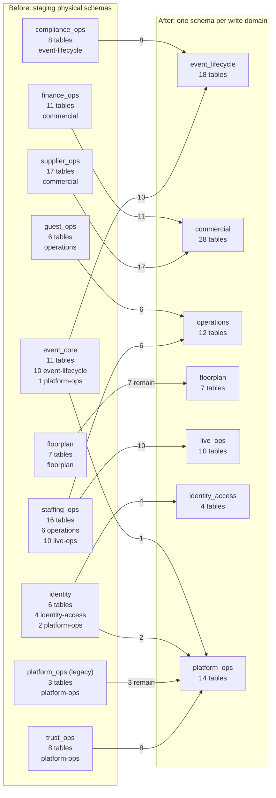

# P.R.I.S.M domain schema map

## At a glance

The current staging layout uses ten application schemas for 93 business
tables. Several schemas mix owners, and some of those tables have foreign keys
across domains. The target puts every business table in its owning context's
schema. Same-domain foreign keys remain valid; cross-domain identifiers remain
scalar references checked through owner capabilities where a command needs
live state.

The target remains one PostgreSQL database, one Prisma client, and one API
deployment. Schema ownership is not a service boundary or a database
authorization boundary. `public._prisma_migrations` is excluded from the
business-table counts below.

## Before: current staging namespace

The labels show physical schema, total table count, and owner split. Arrows
show where each owner slice belongs in the target. Mixed legacy schemas split
across owner schemas.

| Current physical schema | Tables | Owning domain(s) |
| --- | ---: | --- |
| `compliance_ops` | 8 | event-lifecycle |
| `event_core` | 11 | event-lifecycle (10), platform-ops (1) |
| `finance_ops` | 11 | commercial |
| `floorplan` | 7 | floorplan |
| `guest_ops` | 6 | operations |
| `identity` | 6 | identity-access (4), platform-ops (2) |
| `platform_ops` | 3 | platform-ops |
| `staffing_ops` | 16 | operations (6), live-ops (10) |
| `supplier_ops` | 17 | commercial |
| `trust_ops` | 8 | platform-ops |
| **Total** | **93** | **7 write domains** |

## After: target owner schemas

The cutover moves 83 tables and leaves ten already in their target schema. It
drops 45 cross-domain foreign keys and retains the 68 same-domain foreign
keys. No cross-domain Prisma relation or PostgreSQL foreign key remains in the
target.

| Write domain | Target schema | Tables | Columns |
| --- | --- | ---: | ---: |
| event-lifecycle | `event_lifecycle` | 18 | 280 |
| commercial | `commercial` | 28 | 319 |
| operations | `operations` | 12 | 142 |
| live-ops | `live_ops` | 10 | 122 |
| floorplan | `floorplan` | 7 | 75 |
| identity-access | `identity_access` | 4 | 42 |
| platform-ops | `platform_ops` | 14 | 201 |
| **Total** | **7 schemas** | **93** | **1,181** |

## Verification status

A disposable synthetic PostgreSQL clone was brought up through the branch's
four pending forward migrations, then the cutover SQL was applied inside an
explicit transaction. The rehearsal compared every manifest table before and
after: all 93 kept their PostgreSQL relation OID, row count, and index count.
The final catalog had the expected per-schema table totals, 68 same-schema
foreign keys, and zero cross-schema foreign keys. Old mixed-owner schemas were
removed by the migration.

The SQL replay used `psql`; `prisma migrate deploy` was not exercised because
the isolated rehearsal database did not provide Prisma-compatible login
credentials. The cutover has not been applied to staging or production. A
sanitized representative dataset, completed migration-ledger preflight,
alternate-database restore, and release-window approval remain operational
gates. See the [cutover runbook](../runbooks/domain-schema-cutover.md).
