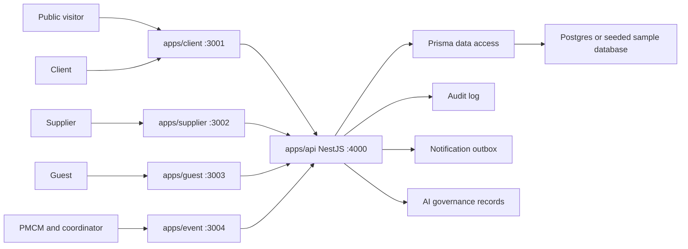

# P.R.I.S.M System Architecture

Date: 2026-06-20
Status: Canonical architecture reference for the current Prism monorepo and July completion plan

This document describes the intended architecture of P.R.I.S.M as PMCM's internal event operating system. Read it with `16-actual-system.md` for full system details, `17-current-state-2026-06-20.md` for the dated implementation snapshot, and `18-future-state.md` for the target state.

## Architecture Principles

| Principle | Rule |
| --- | --- |
| One internal operating system | P.R.I.S.M serves PMCM's event lifecycle. It is not a public SaaS platform and not a generic multi-tenant product. |
| Role-specific apps | PMCM/coordinator, client, supplier, and guest experiences remain separate apps. |
| One shared API | `apps/api` remains the shared NestJS API and owns event operations, authorization checks, workflow services, and persistence access. |
| Scoped contracts first | New role surfaces should use scoped APIs and shared types instead of broad sample-state reads. |
| Compatibility paths are temporary | `/api/sample/state` and local sample state remain for seed/demo/reset compatibility, not for normal feature ownership. |
| PMCM owns official operations | PMCM owns official floorplans, supplier decisions, billing records, compliance overrides, privacy operations, and audit review. |
| Portals are constrained views | Client, supplier, and guest portals only see role-safe event data and cannot access PMCM internals. |
| High-risk dependencies are gated | Real storage, external auth, production notification adapters, QR/camera flows, and live AI require explicit approval, tests, and fallback behavior. |

## Runtime Topology



## Application Boundaries

| App | Port | Primary actors | Owns | Must not own |
| --- | ---: | --- | --- | --- |
| `apps/client` | 3001 | Public visitors and signed-in clients | Landing, inquiry, client sign-in, conforme-gated dashboard, client action center, client-visible billing/docs/floorplan status, layout preferences. | PMCM command center, official floorplan editing, supplier private reviews, PMCM costs, audit logs, privacy operations. |
| `apps/event` | 3004 | PMCM, admin, coordinator role views | PMCM sign-in, command inbox, selected event workspace, official floorplans, supplier review/selection, billing operations, compliance, live ops, coordinator-safe role views, closure, privacy/audit review. | Public marketing pages, supplier self-service, guest public access, client-only dashboard ownership. |
| `apps/supplier` | 3002 | Existing suppliers, awarded suppliers, supplier applicants | Supplier sign-in, assigned quote requests, quote submission/revision, assignment confirmation, readiness, contract metadata, event-day supplier status. | Other suppliers' bids, PMCM private reviews, client private data, internal PMCM costs. |
| `apps/guest` | 3003 | Guests and walk-ins | Access-code entry, lightweight event pass, consented check-in, walk-in flagging, moderated feedback. | Full event planning, client/supplier dashboards, PMCM internals, cross-event guest reads. |
| `apps/api` | 4000 | All apps through HTTP | Shared NestJS API, event operations workflows, role scoping, sample auth, Prisma access, audit, notification outbox, AI governance, compatibility seed/reset paths. | UI rendering, app-local session storage, role-specific visual decisions. |

## Shared Packages

| Package | Responsibility |
| --- | --- |
| `packages/types` | Shared role, session, lifecycle, workflow, action, and data contract types. Session and sample storage keys belong here. |
| `packages/api-client` | Shared request helpers and typed API-client functions for role apps. |
| `packages/ui` | Shared presentation primitives and shell components. It must not contain workflow ownership or role-specific data rules. |
| `packages/tokens` | Shared design tokens, theme values, and Tailwind-related constants. |

## Backend Layering

| Layer | Current owner | Purpose |
| --- | --- | --- |
| Controllers | `apps/api/libs/modules/event-ops/src/controllers` | Stable compatibility HTTP routes for events, PMCM dashboard, supplier workspace, AI PARE routes, and sample compatibility while migrated controllers live in their owning modules. |
| Workflow services | `apps/api/libs/modules/event-ops/src/services` | Business logic for inquiry, onboarding, suppliers, coordinators, billing, compliance, lifecycle, closure, file matrix, live ops, privacy, notifications, audit, AI governance, and PARE foundations. |
| Read models | Event-ops services plus shared DTOs | Actor-scoped payloads such as PMCM command inbox, selected event workspace, client action center, supplier readiness board, guest event pass, file requirements matrix, and close-gate matrix. |
| Persistence | `apps/api/prisma/schema.prisma` | Prisma models for floorplans, events, users, inquiries, documents, suppliers, coordinators, live ops, compliance, billing, closure, notifications, guests, AI audit/approval, login history, and security alerts. |
| Compatibility seed state | `SampleStateService` and `/api/sample/state` | Seed/demo/reset support only. New normal surfaces should not depend on it as their main read path. |


## Backend Modular Monolith Direction

Anthony's active backend implementation plan is `docs/superpowers/plans/2026-06-22-prism-backend-modular-monolith.md`. It keeps one NestJS API and one Prisma client, but changes backend ownership from a centralized `event-ops` hub toward capability modules with explicit public ports, transaction semantics, and role-scoped read models.

July execution is intentionally bounded. Through July 31, 2026, the default backend architecture scope is guardrails, dependency-injection foundation, and transaction/side-effect ports. Capability extraction beyond that requires a child plan that names the affected feature-ledger row, route/app/actor, contract, fallback state, forbidden-role test, route-smoke evidence, and docs updates.

Target backend module ownership:

| Module | Long-term ownership |
| --- | --- |
| `access-control` | Actor resolution, event-scope checks, role and mutation policies. |
| `identity-ops` | Sample auth compatibility, account approval, actor mapping, and future external-auth adapter boundary. |
| `trust-ops` | Audit, privacy operations, login/security evidence, and approved retention/legal-hold behavior. |
| `notification-ops` | Notification outbox rows, retry metadata, template key validation, and send-intent records. |
| `event-core` | Event identity, lifecycle invariants, core status transitions, and workflow command history. |
| `inquiry-onboarding` | Public inquiry, accepted-inquiry gate, conforme path, and client onboarding workflow. |
| `commercial-ops` | Briefing, proposal, package pricing, and conforme-ready commercial workflow. |
| `supplier-ops` | Supplier assignments, quote/readiness workflow, supplier portal actions, and supplier readiness reads. |
| `staffing-ops` | Coordinator staffing, task assignment, and internal staffing views. |
| `finance-ops` | Billing, payments, invoices, adjustments, and finance approval workflow. |
| `compliance-ops` | Compliance workflow, evidence status, and policy-gated event checks. |
| `floorplan` | Official PMCM floorplan workflow and client layout preference/read-only views. |
| `file-ops` | File requirement matrix, upload metadata, document requirement workflow, and signed URL preparation. |
| `guest-ops` | Guest list, access-code scope, RSVP/check-in state, and guest portal payloads. |
| `closure-ops` | Event closure, archive readiness, and post-event evidence assembled from public reader ports. |
| `ai-governance` | AI policy, prompt/template records, review state, and disabled-provider guardrails. |
| `event-read-models` | Role-scoped PMCM/client/supplier/guest payload composition with no writes. |
| `event-ops` | Compatibility facade only while existing routes migrate. |

Executable backend guardrails live in `scripts/check-prism-boundaries.mjs`. The checker now blocks future capability modules from importing other modules' private service internals, prevents new capability modules from importing `event-ops`, prevents `event-read-models` from mutating Prisma state, requires raw read-model queries to live in approved query-builder files with a query budget, and prevents new top-level business service files from being added to the legacy `event-ops` service hub.
Phase 3 infrastructure modules are now active: `event-core` owns workflow command execution and shared event-operation constants, `trust-ops` owns audit/privacy and `AUDIT_WRITER`, `notification-ops` owns notification outbox and `NOTIFICATION_OUTBOX_WRITER`, and `access-control` owns event access policy and `EVENT_ACCESS_POLICY`. `event-ops` remains the compatibility facade for current routes and must not regain cross-cutting provider ownership.

Phase 4 supplier extraction is now partially active: `SupplierNetworkWorkflowService`, `SuppliersService`, the `SUPPLIER_DIRECTORY` provider, `SupplierProfileCommandsService`, and the supplier directory/read-write controllers live in `supplier-ops`, and `event-ops` keeps route compatibility through compatibility re-exports plus provider bindings for remaining supplier workflow dependencies. `supplier-ops` does not import `event-ops`; it owns supplier directory reads and supplier profile writes directly, and consumes PARE, live-operations, and document-vault behavior through public ports while those adjacent capabilities continue to move into owning modules.

Phase 5 finance extraction is now active for command ownership: `BillingOperationsService` and its payment replay tests live in `finance-ops`, and `FinanceOpsModule` owns the runtime provider. Billing read-model composition now lives in `event-read-models`, and Phase 13 moved event-scoped billing source, statement, and payment command routes into a finance-owned controller.

Phase 6 file extraction is now active: `FileRequirementsMatrixService` and `DocumentVaultService` live in `file-ops`, `FileOpsModule` owns the runtime providers and public file tokens, and Phase 13 now registers the event file requirements route from `FileOpsModule`. Signed upload URLs remain disabled through `MetadataOnlySignedUploadUrlFactory`; real object storage requires a separate approved storage plan.

Phase 7A inquiry-onboarding extraction is now active: `InquiriesService`, `InquiryWorkflowService`, and `ClientOnboardingWorkflowService` live in `inquiry-onboarding`, `InquiryOnboardingModule` owns the runtime providers and public inquiry/client-onboarding command tokens, and `event-ops` keeps route compatibility through old-path re-exports plus imported module providers. PMCM onboarding reads now live behind `InquiryWorkflowService.listOnboarding` and the route-level controller moves in Phase 13.

Phase 7B commercial extraction is now active: `CommercialWorkflowService` lives in `commercial-ops`, `CommercialOpsModule` owns quote workflow command/read tokens, and a local `PrismaQuoteSupplierResolver` keeps manual quote supplier resolution out of `event-ops`. `event-ops` keeps route compatibility through an old-path re-export and imported module provider, while Phase 13 now registers PMCM quote request creation, manual quote detail capture, and quote selection routes from `CommercialOpsModule` with PMCM/system actor scope.

Phase 7C compliance extraction is now active: `ComplianceWorkflowService` lives in `compliance-ops`, `ComplianceOpsModule` owns compliance command/read tokens, and the workflow uses public `event-core`, `access-control`, and `trust-ops` providers. Audit persistence remains in `trust-ops`; `event-ops` keeps route compatibility through an old-path re-export and imported module provider.

Phase 8 floorplan extraction is now active: `FloorPlanWorkflowService` lives in `floorplan`, `FloorplanModule` owns floorplan command/read tokens, and the workflow uses public `event-core`, `trust-ops`, and `notification-ops` providers. `event-ops` keeps route compatibility and actor-policy checks, while the persisted canvas/editor shape remains `floorPlan`, `floorPlanObject`, and `opsFloorPlanDraft`.

Phase 9 guest extraction is now active: `GuestWorkflowService` lives in `guest-ops`, `GuestOpsModule` owns `GUEST_COMMANDS` and `GUEST_READER`, and guest access-code resolution, check-in writes, feedback writes, attendance reads, and guest payload mapping now sit behind public guest ports. `event-ops` keeps public guest route compatibility, privacy/readiness/live-ops facade methods delegate guest reads through the guest service, and the selected PMCM event workspace consumes the `GUEST_READER` port for attendance and feedback payloads.

Phase 10 staffing extraction is now active: `CoordinatorsService` lives in `staffing-ops`, `StaffingOpsModule` owns `STAFFING_COMMANDS` and `STAFFING_READER`, and coordinator directory reads, assignment commands, acknowledgement commands, event assignment reads, and coordinator actor assignment resolution now sit behind the staffing module. `event-ops` keeps route compatibility and delegates coordinator workspace reads through `CoordinatorsService`; event-day tasks, urgent issues, attendance, replacement, and status feed behavior remain in live operations until a later live-ops owner extraction; Phase 13 now registers event-scoped coordinator assignment and acknowledgement routes from `StaffingOpsModule`.

Phase 11 event-read-models extraction is now active: `EventReadModelsService` lives in `event-read-models`, `EventReadModelsModule` owns PMCM/client/supplier/billing read-model provider tokens, read-model mapper factories live under `event-read-models/src/mappers`, and cross-domain dashboard reads now run through read-only query builders with explicit query-budget comments plus query-budget regression tests. The module imports public access-control, guest, and staffing ports only; `event-ops` keeps route compatibility through a re-export and controller facade methods until controller ownership moves in Phase 13.

Phase 12 closure-ops extraction is now active: `EventClosureService` lives in `closure-ops`, `ClosureOpsModule` owns `CLOSURE_COMMANDS` and `CLOSURE_READINESS_READER`, and `EventLifecycleService` now lives in `event-core` as a narrow lifecycle invariant service. Archive commands require PMCM/system actor scope before writes, and Phase 13 now registers closure/archive event routes from `ClosureOpsModule`.

Phase 13 controller ownership migration has started: the public guest controller is now registered by `GuestOpsModule` and calls `GuestWorkflowService` directly while keeping `/guest/events/:accessCode`, `/guest/events/:accessCode/check-ins`, and `/guest/events/:accessCode/feedback` stable. Supplier quote-token routes are now registered by `CommercialOpsModule` and call `CommercialWorkflowService` directly while keeping `/quote-requests/:token`, `/quote-requests/:token/quote`, and supplier-facing response filtering stable. Event commercial quote command routes are also registered by `CommercialOpsModule` and call `CommercialWorkflowService` directly for `/events/:eventId/supplier-quotes`, `/events/:eventId/quote-requests`, and `/events/:eventId/supplier-quotes/:quoteId/select` with PMCM/system route policy. Inquiry routes and event briefing submission are now registered by `InquiryOnboardingModule` and call `InquiryWorkflowService` / `ClientOnboardingWorkflowService` directly while keeping public inquiry, PMCM log-on-behalf, status, reminder, conforme upload, and briefing route contracts stable. Billing workspace reads are now registered by `EventReadModelsModule` and call `EventReadModelsService.billing` directly while composing billing mappers from `finance-ops`. Notification acknowledgement is now registered by `NotificationOpsModule` and calls `NotificationOutboxService.acknowledge` directly. Client workspace and action-center reads are now registered by `EventReadModelsModule` and call `EventReadModelsService.clientWorkspace` / `clientActionCenter` directly. Coordinator directory reads are now registered by `StaffingOpsModule` and call `CoordinatorsService.listCoordinators` directly. Onboarding reads are now registered by `InquiryOnboardingModule` and call `InquiryWorkflowService.listOnboarding` directly. Audit and privacy routes are now registered by `TrustOpsModule` and call `AuditService` / `PrivacyOperationsService` directly, including privacy inventory composition. The PMCM command-inbox, dashboard, event-workspace, and event list/detail reads are now registered by `EventReadModelsModule` and call `EventReadModelsService` directly with event-read-model-owned mappers. Auth routes are now registered by `IdentityOpsModule` and call `AuthOperationsService` directly while old auth service/controller paths remain compatibility re-exports. AI governance dry-run is now registered by `AiGovernanceModule` and calls `AiGovernanceService` directly while `/ai/pare/*` stays in the AI compatibility controller. Supplier directory reads, supplier profile write routes, and supplier portal assignment/readiness/contract command routes are now registered by `SupplierOpsModule` and call supplier-owned services directly while supplier workspace reads and event-status remain in compatibility controllers. Compliance rule routes and event-scoped compliance execution/resolution routes are now registered by `ComplianceOpsModule`. Event floorplan routes are now registered by `FloorplanModule` and call `FloorPlanWorkflowService` directly with route-local policy checks. Event billing command routes are now registered by `FinanceOpsModule` and call `BillingOperationsService` directly with PMCM/system route policy. Closure/archive routes are now registered by `ClosureOpsModule` and call `EventClosureService` directly for close gates, post-event document completion, archive, and insights while using public guest/floorplan reader ports for response mapping. Event file requirements are now registered by `FileOpsModule` and call `FileRequirementsMatrixService` directly with access-control policy and role-visible item filtering. Coordinator workspace reads are now registered by `StaffingOpsModule`; coordinator event role-view remains in the compatibility controller until live-ops composition moves. Remaining quote-request withdrawal, supplier workspace reads/event-status, coordinator attendance/replacement, event command/live route groups, and other controller families remain in `event-ops` until their owning modules receive route-level controllers.

## Data Domains

| Domain | Representative models |
| --- | --- |
| Floorplans and venue templates | `FloorPlan`, `FloorPlanObject`, `VenueTemplate`, `PublishedSnapshot`, `OpsFloorPlanDraft` |
| Core event lifecycle | `OpsInquiry`, `OpsEvent`, `OpsApprovalRequest`, `OpsDocument`, `OpsBriefing`, `OpsPostEventDocument`, `OpsEventInsight` |
| Supplier network | `OpsSupplier`, `OpsSupplierCategory`, `OpsSupplierReview`, `OpsSupplierReliabilityNote`, `OpsSupplierCertification`, `OpsSupplierQuoteRequest`, `OpsSupplierQuote` |
| Coordinator and live ops | `OpsCoordinator`, `OpsCoordinatorAssignment`, `OpsEventDayTask`, `OpsUrgentIssue`, `OpsEventDayLog`, `OpsCoordinatorReliabilityNote` |
| Compliance and billing | `OpsComplianceRule`, `OpsComplianceCheck`, `OpsBillingSource`, `OpsBillingStatement`, `OpsPaymentMilestone`, `OpsPaymentRecord` |
| Trust, privacy, and audit | `OpsUser`, `OpsPrivacyRequest`, `OpsAuditLog`, `OpsNotificationLog`, `OpsLoginHistory`, `OpsSecurityAlert` |
| Guest operations | `OpsGuestCheckIn`, `OpsGuestFeedback` |
| AI governance | `OpsAiAuditLog`, `OpsAiApprovalRecord` |

## Database Schema Domains

The database domain-separation branch maps Prisma models to Postgres schemas while keeping one shared Prisma client and one NestJS API. Runtime tables are grouped by ownership domain: `floorplan`, `identity`, `event_core`, `supplier_ops`, `staffing_ops`, `finance_ops`, `compliance_ops`, `guest_ops`, and `trust_ops`. `public` is reserved for `_prisma_migrations` and explicitly approved compatibility objects only.

Physical table names, index names, and constraint names are normalized to lowercase snake case without the old redundant `ops_` prefix once the table lives inside its domain schema. Prisma model names remain stable in this implementation pass to reduce API and service churn.

Database review commands live in `apps/api/package.json`:

```bash
npm run prisma:validate
npm run db:verify:offline
npm run db:audit:queries
npm run db:audit:schemas
npm run db:audit:naming
npm run db:audit:indexes
npm run db:perf:report
```

The live schema, naming, and FK-index audits must run only against a database that has received the schema-split migrations. As of the 2026-06-22 DB migration review, those audits passed against the shared Supabase target after backup and migration deployment. `db:perf:report` reads `pg_stat_statements` with credential redaction; re-run it after representative app traffic before treating the ranking as an event-ops workload profile.
## Lifecycle Architecture

| Lifecycle step | Primary app | API ownership | Required boundary |
| --- | --- | --- | --- |
| Public inquiry | `apps/client` | Inquiry controller and inquiry workflow service | Public submitters cannot set PMCM-only fields. |
| Inquiry review | `apps/event` | PMCM dashboard, inquiries, audit | PMCM owns accept, pend, decline, duplicate/referral review, and log-on-behalf metadata. |
| Conforme gate | `apps/event`, `apps/client` | Onboarding workflow, approval requests, documents | Client dashboard and event creation remain gated by accepted inquiry plus signed conforme. |
| Briefing and proposal | `apps/event`, limited `apps/client` view | Commercial workflow, billing source, documents | PMCM prepares; client sees approved/client-safe artifacts only. |
| Planning | `apps/event`, `apps/client`, `apps/supplier` | Event workspace, file matrix, floorplan, suppliers, billing, compliance | PMCM owns official records; portals receive scoped views. |
| Event day | `apps/event`, `apps/supplier`, `apps/guest` | Live operations, coordinator workspace, supplier workspace, guest workflow | Role-safe run data only. |
| Closure/archive | `apps/event`, limited `apps/client` view | Event closure, close gates, insights, documents, billing | Archive is blocked unless gates pass or PMCM records an override reason. |

## Role-Boundary Matrix

| Data or action | PMCM/event app | Client portal | Supplier portal | Guest portal |
| --- | --- | --- | --- | --- |
| Public inquiry submit | Review and decision | Submit only | Not applicable | Not applicable |
| Accepted inquiry and conforme status | Full operational status | Own event status only | Not applicable | Not applicable |
| Official floorplan | Create, edit, submit, approve, lock | Read-only review plus preference/comment actions | Event-day logistics if assigned | Not visible |
| Supplier quotes | Create, compare, select, close | Not visible except approved client-facing proposal output | Own quote request and own submission | Not visible |
| Supplier private review/reliability | Full PMCM access | Not visible | Not visible | Not visible |
| Billing records | Full PMCM billing operations | Statements, milestones, receipts, client actions only | Not visible unless supplier contract metadata | Not visible |
| Live ops | Full PMCM and coordinator-safe views | Client-safe status only if exposed | Own assignment/status | Check-in/pass only |
| Audit and privacy operations | PMCM-only | Own privacy request path only if exposed | Own privacy request path only if exposed | Consent and own feedback only |
| AI suggestions | PMCM approval required | No autonomous AI action | No autonomous AI action | No autonomous AI action |

## State And Session Rules

1. Browser session and sample storage key names belong in `@prism/types`.
2. Role apps should use shared helpers instead of adding new literal `prism:*` keys.
3. API-backed sample auth/RBAC is acceptable for the current pass.
4. External auth is gated until provider, session migration, tests, and fallback behavior are approved.
5. Local sample state is allowed for seed/demo/reset compatibility only.

## Integration And Adapter Boundaries

| Integration area | Architecture status |
| --- | --- |
| Database | Prisma-backed Postgres path exists. Domain-schema separation is implemented through Prisma multi-schema mapping, schema/table/index/constraint migrations, and audit scripts; the shared Supabase target was backed up, migrated, and verified with live schema, naming, FK-index, and migration-status audits during the 2026-06-22 DB migration review. Free-tier Supabase pooler use requires the documented runtime guard and should not be treated as a production direct connection substitute. |
| File storage | Metadata and file requirements matrix exist. Real storage, signed URLs, upload progress, retry, download/delete audit, and adapter tests remain gated. |
| Notifications | Queue/retry/acknowledgement model exists. Production SendGrid/Viber adapters remain gated. |
| AI | Data sanitizer, audit, approval, and PARE foundation exist. Live AI calls and autonomous AI actions remain gated by ZDR/provider approval and PMCM human approval. |
| QR/camera | Guest access-code path exists. QR/camera scanning remains gated by HTTPS/device constraints and masterlist reconciliation. |

## Architecture Verification

| Check | Command or evidence |
| --- | --- |
| App/package boundaries | `npm run check:boundaries` |
| Root type safety | `npm run typecheck` |
| Root build | `npm run build` |
| API event-ops tests | `npm --workspace prism-api run test:event-ops` |
| API Prisma schema | `npm --workspace prism-api run prisma:validate` |
| UI smoke | `npm run smoke:ui` |
| Documentation consistency | `git diff --check` plus index/manifest updates |

## Architecture Stop Rules

Stop and update the plan before implementation if a change would:

1. Move PMCM command ownership into `apps/client`.
2. Let client, supplier, guest, or coordinator actors read PMCM-only records.
3. Treat `/api/sample/state` as the main path for new role features.
4. Add an app-local literal `prism:*` session key.
5. Ship real storage, production notifications, external auth, QR/camera, or live AI without the required gate evidence.
6. Put workflow ownership inside `packages/ui`.
7. Claim a feature is complete without route, actor, contract, failure-state, and permission-boundary evidence.
