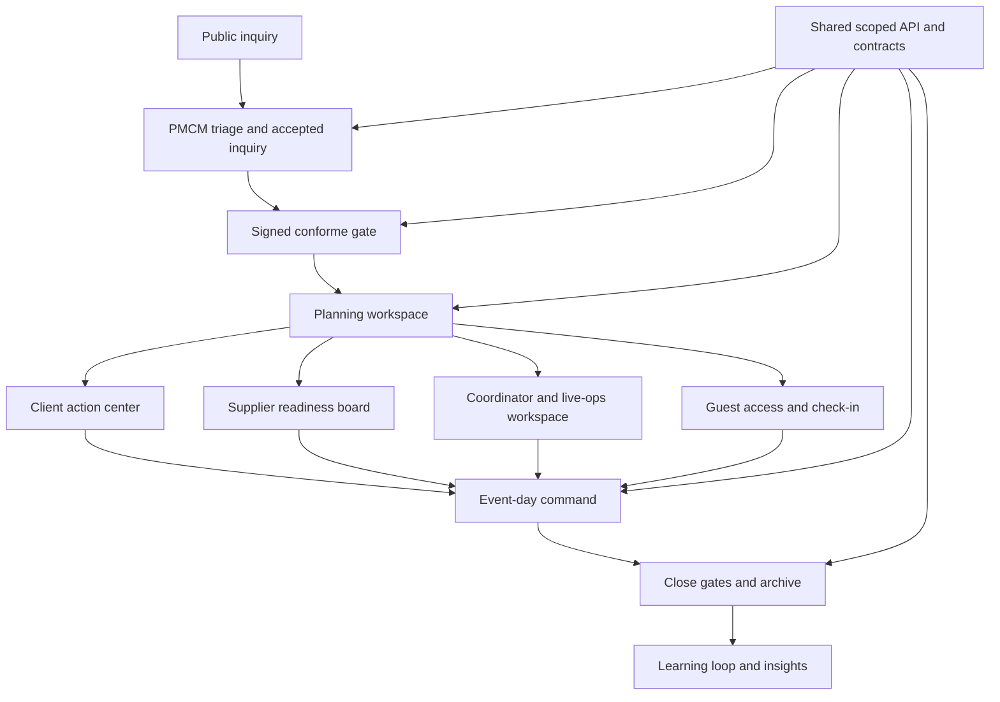

# P.R.I.S.M Future State

Date: 2026-06-20
Status: Target-state document for July 31, 2026 completion planning and post-July maturity

This document describes where P.R.I.S.M should land after the July completion calendar and what remains for post-July maturity. It should be read after `15-system-architecture.md` for architecture, `16-actual-system.md` for full system details, and `17-current-state-2026-06-20.md` for the dated implementation snapshot.

## Target System Statement

P.R.I.S.M should become PMCM's trusted internal event operating system: a role-safe, evidence-backed command layer that carries an event from public inquiry through client onboarding, planning, supplier and coordinator execution, guest operations, event-day control, closure, archive, and learning loop.

The future state is not "every catalog item is production-grade by July 31." The future state is:

1. Every feature family has an explicit outcome.
2. Every lifecycle step has a working route-safe slice or a named gate.
3. Every high-risk dependency has an approved implementation path or post-July owner.
4. Every role app preserves its boundary.
5. The system can be demonstrated as one coherent PMCM story.

## July 31 Target State

| Area | July 31 target |
| --- | --- |
| Lifecycle continuity | Inquiry -> accepted inquiry -> signed conforme -> planning -> event day -> closure/archive can be demonstrated with route, actor, contract, screenshot/route check, and known gates. |
| PMCM command | `apps/event` starts from the Event Command Inbox and selected-event workspace. Remaining broad dashboard sections are documented as compatibility or post-July. |
| Client portal | `apps/client` starts from a next-action center with client-safe event tasks, documents, billing, floorplan review, and closeout signals. |
| Supplier portal | `apps/supplier` clearly shows supplier quote/assignment/readiness/contract/event-day status for assigned supplier scope. |
| Guest portal | `apps/guest` supports event-code access, consent, check-in, walk-in flagging, attendance, and moderated feedback without QR overclaiming. |
| Files | File Requirements Matrix is metadata-complete and role-visible; real storage remains gated unless explicitly approved. |
| Floorplans | PMCM official floorplan ownership is preserved; clients only submit preferences/comments and review submitted/approved official snapshots read-only. |
| Billing | Billing evidence is client-safe and source-linked; disputes, waivers, corrections, and additional billing are gated or post-July unless implemented with tests. |
| Compliance and risk | Compliance rule/override evidence is live; broader risk/change register is gated or selected as one PMCM thin slice. |
| Closure | Close gates and lifecycle transition rules support closure/readiness evidence. |
| Security and privacy | Sample auth/RBAC, privacy request handling, consent, redaction, audit integrity, and role boundaries are verified. External auth remains gated unless approved. |
| AI | AI governance foundation is visible. Live AI and autonomous action remain gated behind ZDR/provider approval and PMCM approval workflow. |
| UX | Maxine's route-review log covers touched PMCM/client/supplier/guest surfaces with route, viewport, pass/fail, and fix/approval notes. |
| Evidence | Anthony's final evidence packet links FL outcomes, route checks, screenshots, tests, dependency decisions, and docs updates. |

## Future Architecture Target

## Future State By Owner

| Owner | Future outcome |
| --- | --- |
| Maxine | The whole system feels coherent across PMCM, client, supplier, and guest routes without violating role boundaries. Each touched surface has responsive state language, dense operational layout, and no banned visual treatments. |
| Francis | PMCM and coordinator operations are usable: command inbox, selected event workspace, supplier/quote/floorplan/billing/compliance/live-ops/closure evidence, and exactly chosen Sprint 3 depth slice. |
| Ethan | External portals are safe and useful: client action center, supplier readiness board, guest access/check-in/feedback, with no PMCM data leakage or hidden broad sample dependency. |
| Anthony | Platform trust is explicit: scoped contracts, file matrix, session keys, privacy/audit, auth/runtime decisions, dependency gates, route evidence, source-ID traceability, and final completion matrix. |

## Future State By Feature Outcome

| Outcome | Meaning | Expected July examples |
| --- | --- | --- |
| Delivered | The route, contract, role boundary, failure state, and evidence are complete enough for July. | Event Command Inbox, Client Action Center if fallback is closed or clearly bounded. |
| Thin delivered | A bounded working slice is complete and honest about remaining maturity. | File Requirements Matrix metadata, supplier readiness board, guest access-code/check-in, close gates. |
| Gated | Work is blocked until a prerequisite is approved or implemented. | Storage, production notifications, external auth, QR/camera, live AI, broader risk/change if not selected. |
| Deferred | Valid but not part of July completion. | Deeper billing disputes, archive comparison, testimonial library, supplier application status center if not needed for demo. |
| Post-July | Explicitly outside July build capacity with a future owner. | Workflow Template Builder, health formula editor, storage adapter readiness console if not approved. |

## Post-July Target State

| Area | Post-July maturity target |
| --- | --- |
| External auth | Replace sample auth/RBAC with approved provider integration, migration path, session tests, and rollback/fallback behavior. |
| Storage | Add storage adapter, signed URLs, upload progress/retry, download/delete audit, file previews where appropriate, and storage readiness console. |
| Notifications | Connect production delivery adapters behind the queue, with templates, language preference, retry audit, failures, and delivery health. |
| AI | Connect a ZDR-approved provider only after governance review, sanitizer, audit, approval records, prompt/version retention, and human-in-the-loop PMCM approval. |
| QR/camera | Add QR scanning only after HTTPS/device constraints and masterlist reconciliation are solved. |
| Supplier applications | Complete supplier application intake, PMCM review, applicant status center, and supplier onboarding evidence. |
| Coordinator staffing | Complete availability, heatmap, skills matching, conflict rules, replacement options, and coordinator-safe run views. |
| Risk/change | Complete risk/change register, freeze exceptions, addendum conformes, cancellation/postponement impact, and decision-log linkage. |
| Event health | Implement deterministic formula, thresholds, stale-data handling, route placement, and test evidence. |
| Decision log | Build audit-backed decision log with filters, actors, reasons, source workflow, and override linkage. |
| Archive and learning loop | Add archive search/comparison, testimonial library, richer feedback capture, and post-event knowledge surfacing. |
| Workflow templates | Build template authoring, versioning, permissions, reuse across workflows, and migration from existing plans/templates. |

## Migration From Current To Future

| Step | Action | DRI |
| --- | --- | --- |
| 1 | Preserve the app split and reject any all-role `apps/client` shell direction. | Anthony |
| 2 | Finish final FL-001 through FL-028 outcome matrix. | Anthony |
| 3 | Build route evidence packet for the lifecycle story. | Anthony |
| 4 | Decompose one more selected-event PMCM surface and gate non-selected PMCM depth slices. | Francis |
| 5 | Confirm supplier and guest route evidence before expanding client polish. | Ethan |
| 6 | Apply route-review log to touched real surfaces. | Maxine |
| 7 | Keep storage, notifications, auth, QR, and AI gated unless approved with tests and fallback behavior. | Anthony |
| 8 | Add post-July queue grouped by PMCM, client, supplier, guest, platform, and UX. | Anthony |

## Future Dependency Decisions

| Dependency | Required decision before implementation |
| --- | --- |
| External auth | Provider, role mapping, session migration, local/dev fallback, test matrix, and rollback plan. |
| Storage | Provider, bucket/object model, signed URL policy, retention, MIME/size validation, virus/malware decision, audit events, retry/progress behavior. |
| Notifications | Provider, credentials, template versioning, recipient scoping, retry/terminal failure semantics, unsubscribe/consent where applicable, audit events. |
| AI | Provider, ZDR agreement, prompt/data policy, sanitizer proof, approval workflow, audit retention, failure mode, no-autonomous-action rule. |
| QR/camera | HTTPS plan, device support, fallback code path, masterlist reconciliation, privacy/consent language, route tests. |

## Future Evidence Packet

By July 31, the completion packet should include:

1. Feature outcome matrix for FL-001 through FL-028.
2. Catalog ID traceability audit output.
3. Route evidence for public inquiry, PMCM command, selected event, client action center, supplier readiness, guest access/check-in, and closure/readiness.
4. Boundary test or route proof for client/supplier/guest/coordinator role constraints.
5. External dependency decision table.
6. UX route-review log.
7. Test/build/typecheck command results relevant to changed areas.
8. Final docs sync list.
9. Post-July queue with owner and reason.

## Future Completion Rule

The whole system is complete enough for the July 31 milestone when each lifecycle step can be demonstrated honestly and every incomplete piece is either:

- Delivered with evidence.
- Thin delivered with explicit remaining work.
- Gated with prerequisite and owner.
- Deferred with reason.
- Post-July with owner and expected maturity path.

No future review should call the system complete if it only has static UI, mock state, or untested role boundaries.
