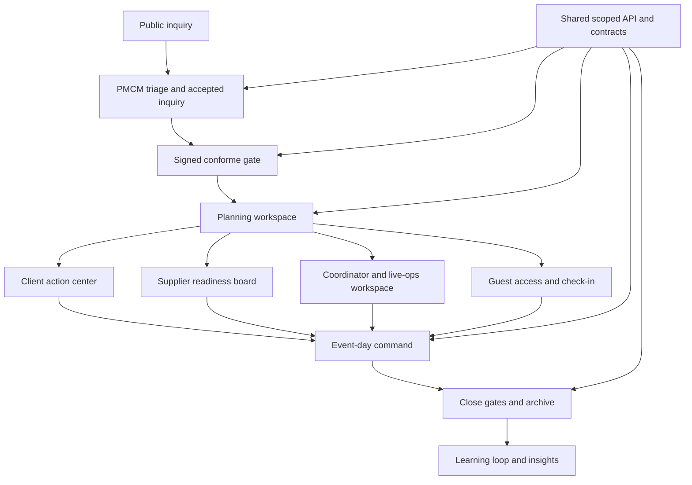

# P.R.I.S.M future state

## At a glance

- **Purpose:** Describe the durable target outcomes for a trusted, role-safe PMCM event operating system.
- **Authority:** Informative target model; the feature ledger records active work and ADRs govern architecture.
- **Scope:** Product maturity, role outcomes, evidence, governance, and incremental migration direction.
- **Use when:** Choosing whether proposed work advances the product target.
- **Change when:** Target outcomes, maturity gates, or migration direction changes.
- **Verify with:** The current product model, feature ledger, readiness gates in evolution governance, and architecture decisions.

This document describes where P.R.I.S.M should land for full-system maturity.
Read it after [`../architecture/current-architecture.md`](../architecture/current-architecture.md)
for architecture and [`actual-system.md`](actual-system.md) for current system
detail.

## Target System Statement

P.R.I.S.M should become PMCM's trusted internal event operating system: a role-safe, evidence-backed command layer that carries an event from public inquiry through client onboarding, planning, supplier and coordinator execution, guest operations, event-day control, closure, archive, and learning loop.

The future state is not "every catalog item is production-grade immediately." The future state is:

1. Every feature family has an explicit outcome.
2. Every lifecycle step has a working route-safe slice or a named gate.
3. Every high-risk dependency has an approved implementation path or a named deferred owner.
4. Every role app preserves its boundary.
5. The system can be demonstrated as one coherent PMCM story.

## Near-Term Target State

| Area | Near-term target |
| --- | --- |
| Lifecycle continuity | Inquiry -> accepted inquiry -> signed conforme -> planning -> event day -> closure/archive can be demonstrated with route, actor, contract, screenshot/route check, and known gates. |
| PMCM command | `apps/event` starts from the Event Command Inbox and selected-event workspace. Remaining broad dashboard sections are documented as compatibility or deferred. |
| Client portal | `apps/client` starts from a next-action center with client-safe event tasks, documents, billing, floorplan review, and closeout signals. |
| Supplier portal | `apps/supplier` clearly shows supplier quote/assignment/readiness/contract/event-day status for assigned supplier scope. |
| Guest portal | `apps/guest` supports event-code access, consent, check-in, walk-in flagging, attendance, and moderated feedback without QR overclaiming. |
| Files | File Requirements Matrix is role-visible and counts only verified uploads through the configured storage adapter; production provider activation, retention, and malware scanning remain gated. |
| Floorplans | PMCM official floorplan ownership is preserved; clients only submit preferences/comments and review submitted/approved official snapshots read-only. |
| Billing | Billing evidence is client-safe and source-linked, including disputes, reasoned waivers, two-person corrections, and source-traced additional billing. |
| Compliance and risk | Compliance rule/override evidence, change requests, freeze exceptions, addendum acknowledgment, and recorded risk level are live; interactive rescheduling and addendum effect timing remain open. |
| Closure | Close gates and lifecycle transition rules support closure/readiness evidence. |
| Security and privacy | Built-in API auth/RBAC, privacy request handling, consent, redaction, audit integrity, and role boundaries are verified. External auth remains gated unless approved. |
| AI | AI governance foundation is visible. Live AI and autonomous action remain gated behind ZDR/provider approval and PMCM approval workflow. |
| UX | Route-review evidence covers touched PMCM/client/supplier/guest surfaces with route, viewport, pass/fail, and fix/approval notes. Route-level redesign follows the ledger's family decisions: generic dashboards, file hubs and task lists become command inboxes, action centers, requirement matrices and run sheets. |
| Evidence | Evidence packets link FL outcomes, route checks, screenshots, tests, dependency decisions, and docs updates. |

## Future Architecture Target

## Future State By Area

| Area | Future outcome |
| --- | --- |
| UX | The whole system feels coherent across PMCM, client, supplier, and guest routes without violating role boundaries. Each touched surface has responsive state language, dense operational layout, and no banned visual treatments. |
| PMCM operations | PMCM and coordinator operations are usable: command inbox, selected event workspace, supplier/quote/floorplan/billing/compliance/live-ops/closure evidence, and exactly one chosen staffing/live-ops depth slice when scoped. |
| External portals | External portals are safe and useful: client action center, supplier readiness board, guest access/check-in/feedback, with no PMCM data leakage or hidden broad sample dependency. |
| Platform trust | Platform trust is explicit: scoped contracts, file matrix, session keys, privacy/audit, auth/runtime decisions, dependency gates, route evidence, source-ID traceability, and completion matrix. |

## Future State By Feature Outcome

| Outcome | Meaning | Expected near-term examples |
| --- | --- | --- |
| Delivered | The route, contract, role boundary, failure state, and evidence are complete enough to claim the family. | Event Command Inbox, Client Action Center if fallback is closed or clearly bounded. |
| Thin delivered | A bounded working slice is complete and honest about remaining maturity. | File Requirements Matrix metadata, supplier readiness board, guest access-code/check-in, close gates. |
| Gated | Work is blocked until a prerequisite is approved or implemented. | Storage, production notifications, external auth, QR/camera, live AI, broader risk/change if not selected. |
| Deferred | Valid but not in the current delivery slice. | Testimonial library, health formula, staffing heatmap. |
| Later maturity | Explicitly outside current build capacity with an explicit future scope and revisit condition. | Workflow Template Builder, health formula editor, storage adapter readiness console if not approved. |

## Later Maturity Target State

| Area | Later maturity target |
| --- | --- |
| External auth | Replace built-in API auth/RBAC with approved provider integration, migration path, session tests, and rollback/fallback behavior. |
| Storage | Activate the production storage provider with retention, malware scanning, multipart/bulk upload, file previews where appropriate, and a storage readiness console. |
| Notifications | Connect production delivery adapters behind the queue, with templates, language preference, retry audit, failures, and delivery health. |
| AI | Connect a ZDR-approved provider only after governance review, sanitizer, audit, approval records, prompt/version retention, and human-in-the-loop PMCM approval. |
| QR/camera | Add QR scanning only after HTTPS/device constraints and masterlist reconciliation are solved. |
| Coordinator staffing | Complete availability, heatmap, skills matching, conflict rules, replacement options, and coordinator-safe run views. |
| Risk/change | Complete interactive cancellation/postponement handling, addendum effect timing, client decision notices, and decision-log linkage. |
| Event health | Implement deterministic formula, thresholds, stale-data handling, route placement, and test evidence. |
| Decision log | Remove the read caps and add pending requests and override linkage to the read-only decision log. |
| Archive and learning loop | Add a testimonial library, richer feedback capture, and post-event knowledge surfacing on top of archive search/comparison. |
| Workflow templates | Build template authoring, versioning, permissions, reuse across workflows, and migration from existing plans/templates. |

## Migration From Current To Future

| Step | Action |
| --- | --- |
| 1 | Preserve the app split and reject any all-role `apps/client` shell direction. |
| 2 | Finish final FL-001 through FL-028 outcome matrix. |
| 3 | Build route evidence packet for the lifecycle story. |
| 4 | Decompose one more selected-event PMCM surface and gate non-selected PMCM depth slices. |
| 5 | Confirm supplier and guest route evidence before expanding client polish. |
| 6 | Apply route-review log to touched real surfaces. |
| 7 | Keep storage, notifications, auth, QR, and AI gated unless approved with tests and fallback behavior. |
| 8 | Maintain a deferred/later queue grouped by PMCM, client, supplier, guest, platform, and UX. |

## Future Dependency Decisions

| Dependency | Required decision before implementation |
| --- | --- |
| External auth | Provider, role mapping, session migration, local/dev fallback, test matrix, and rollback plan. |
| Storage | Provider, bucket/object model, signed URL policy, retention, MIME/size validation, virus/malware decision, audit events, retry/progress behavior. |
| Notifications | Provider, credentials, template versioning, recipient scoping, retry/terminal failure semantics, unsubscribe/consent where applicable, audit events. |
| AI | Provider, ZDR agreement, prompt/data policy, sanitizer proof, approval workflow, audit retention, failure mode, no-autonomous-action rule. |
| QR/camera | HTTPS plan, device support, fallback code path, masterlist reconciliation, privacy/consent language, route tests. |

## Backend Target

The backend stays a modular monolith in `apps/api` with Prisma as the shared
data-access layer. Context ownership, read-model composition, and kernel rules
are defined in
[`../architecture/current-architecture.md`](../architecture/current-architecture.md);
product work must not recreate a god hub or whole-system sample routes.

## Future Evidence Packet

A completion claim should include:

1. Feature outcome matrix for FL-001 through FL-028.
2. Catalog ID traceability audit output.
3. Route evidence for public inquiry, PMCM command, selected event, client action center, supplier readiness, guest access/check-in, and closure/readiness.
4. Boundary test or route proof for client/supplier/guest/coordinator role constraints.
5. External dependency decision table.
6. UX route-review log.
7. Test/build/typecheck command results relevant to changed areas.
8. Docs sync list for living Tier 1 files touched by the claim.
9. Deferred/later queue with owner and reason.

## Future Completion Rule

The whole system is complete enough for a milestone claim when each lifecycle step can be demonstrated honestly and every incomplete piece is either:

- Delivered with evidence.
- Thin delivered with explicit remaining work.
- Gated with prerequisite and owner.
- Deferred with reason.
- Later maturity with owner and expected path.

Do not call the system complete if it only has static UI, mock state, or untested role boundaries.
