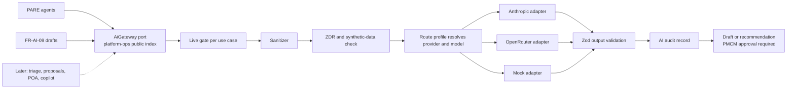

# Interchangeable AI provider gateway

## At a glance

- **Purpose:** Make every P.R.I.S.M AI use case independent of its provider. A
  use case declares what it needs; configuration decides which approved
  provider and model serve it, so Anthropic, OpenRouter, or a later provider
  can be swapped without changing feature code.
- **Authority:** Informative execution plan. The feature ledger, readiness
  foundation, and FR-AI-ZDR governance remain authoritative for product
  behavior. Durable decisions are promoted into an ADR in PR 7, after which
  this plan is removed.
- **Owner:** D (Anthony) owns the gateway, the governance gate, and provider
  approval. B (Francis) co-owns the PARE and communication-draft workflows.
  A (Maxine) owns the draft review surface.
- **Scope:** PRs 0 to 7 below, with PRs 2 to 5 developed in parallel after
  verification and contract freeze. Production live AI on real data is out of
  scope until D records a separate provider approval.
- **Approval:** D (Anthony) approved the original phase plan on 2026-09-24.
  This PR breakdown refines execution; PR 0's route decision and approval
  for live AI on real data are recorded separately.
- **Use/change:** Update when a PR closes, PR 0 changes a decision, or a
  provider or model route is added or removed.
- **Verify with:** Each PR's exit check, the provider conformance suite,
  `npm run check:boundaries`, API tests, and proof that blocked paths make no
  network call.

## Goal

Interchangeable means four things:

1. Feature code calls `AiGateway.run` or `AiGateway.stream` with a use-case
   ID and a typed input. It never imports a provider SDK, names a model, or
   reads a provider key.
2. The active route profile chooses a route (provider, model, provider
   options) for each use case. Switching providers is a configuration change
   that is validated when the API starts.
3. A route may serve a use case only after it passes the same conformance
   suite as every other route for that use case.
4. Sanitizing, ZDR checks, limits, output validation, audit, and the PMCM
   approval rule run inside the gateway for every route, so adding a provider
   cannot bypass them.

## Current state

Verified at `a95ab19`:

- Only PARE calls a model. `budget.agent.ts`, `risk.agent.ts`, and
  `message-drafter.agent.ts` each create
  `new Anthropic({ apiKey: process.env.ANTHROPIC_API_KEY })`, hardcode
  `claude-sonnet-4-6`, and carry their own copy of a six-turn tool loop.
- `pare-execution.policy.ts` rejects every mode except `mock`, so live PARE
  fails before any SDK import.
- `pare.service.ts` writes `OpsAiAuditLog` with `modelVersion: 'mock'` and
  `zdrConfirmed: true`, and infers live mode from
  `modelVersion === 'claude-sonnet-4-6'`. Any other model or provider would be
  reported as mock.
- When a live tool loop runs out of turns, all three agents return their mock
  result. In live mode that would present deterministic output as model output.
- `OpsAiAuditLog` has no columns for provider, route, prompt version, token
  usage, latency, or the basis of the ZDR claim.
- The current PARE sanitizer recognizes selected PII field names; free text
  and tool results need their own outbound-data tests before real-data use.
- PARE approval checks currently accept only mock audit evidence. The
  migration must preserve PMCM review while accepting verified live evidence.
- The unsigned-conforme reminder sweep already sends deterministic messages;
  FR-AI-09 must claim or deduplicate its reminder window with that workflow.
- The API compiles to CommonJS (`module: commonjs`, `moduleResolution: node`).
  The root `package.json` requires Node `>=24`.
- The V4 catalog's FR-AI-ZDR entry assumes a ZDR agreement with Anthropic.
  P.R.I.S.M cannot obtain one, so the governance record must move to the new
  provider path before any real data reaches a model.

## Decisions

| Topic | Decision |
| --- | --- |
| Library | Keep the `AiGateway` port independent of transport. The current CommonJS build and Vercel's published AI SDK 7 ESM requirement make `require(esm)` an unsupported default. PR 0 records the implementation choice: direct adapters using the existing `@anthropic-ai/sdk` and an OpenRouter HTTP client are the baseline; an isolated, supported ESM bridge is acceptable only if built API, Vitest, and Docker checks prove it. |
| Placement | The `AiGateway` port lives in `platform-ops` contracts and is exported from `modules/platform-ops/index.ts`. Adapters live in `platform-ops/infrastructure/ai-governance`. Other contexts depend only on the port and supply their own tool handlers. |
| Configuration | The use-case registry and the route profiles are code, reviewed in PRs. Environment variables select a profile, hold keys, and list which use cases may go live. Everything is validated with Zod at startup. Invalid AI configuration fails startup only when a live use case is enabled; otherwise AI stays in mock and health reports it. |
| Production route | OpenRouter `z-ai/glm-5.3-flash` is the first candidate, with ZDR required, provider endpoints pinned to verified ZDR slugs, and data collection denied. PR 0 may replace it if the route cannot meet tool and ZDR requirements. |
| Test route | Anthropic direct `claude-sonnet-4-6` on existing credits. It has no ZDR, so it accepts synthetic data only and is refused in production. |
| Failures | Fail closed. Retry the same route within limits. Never fail over to another provider or profile. Never substitute mock output in live mode. |
| Streaming | The port has `stream` from PR 1. FR-AI-09 uses it in PR 5. The input types leave room for multi-turn chat (FR-AI-05 POA, FR-AI-07 copilot), which is built later. |
| New use case | FR-AI-09 client communication drafts, starting with the unsigned-conforme trigger. |
| Done for this plan | PRs 0 to 7 merged; both selected routes pass the conformance suite; a staging pilot on synthetic data succeeds; production live AI stays off until D separately approves the real-data route. |

## Architecture



### Use-case registry

Each use case is one registry entry:

| Field | Meaning |
| --- | --- |
| `id` | Stable ID such as `pare.budget`, `pare.risk`, `pare.message-drafts`, `comms.draft`. |
| `promptVersion` | Version of the system prompt and instructions; recorded on every call. |
| `input`, `output` | Zod schemas in `@prism/types`. Output that fails validation is a failure. |
| `tools` | Tool names with Zod input schemas; the owning context supplies handlers. |
| `modelTier` | `fast` or `strong`. Profiles map tiers to models, so a use case never names a model. |
| `dataClasses` | Data categories the use case may send after sanitizing. |
| `requiresZdr` | `true` for any use case that can receive real event data. |
| `approval` | Always `pmcm-required`. The gateway returns drafts and recommendations only. |
| `limits` | Maximum steps, output tokens, timeout, and daily token budget. |
| `delivery` | `run` or `stream`. |

### Route profiles

| Profile | Purpose | Routes | Data allowed |
| --- | --- | --- | --- |
| `mock` | Default, CI, and tests | Deterministic adapter; output labeled `mock` | Any |
| `test-anthropic` | Local and staging model testing | Both tiers to `anthropic:claude-sonnet-4-6` | Synthetic only; refused when `NODE_ENV=production` |
| `prod-openrouter-zdr` | Staging pilot, then production after approval | Both tiers to `openrouter:z-ai/glm-5.3-flash` at first; `strong` can move to another ZDR model without code changes | Sanitized real data, only after D's approval |

Environment variables:

| Variable | Meaning |
| --- | --- |
| `AI_ROUTE_PROFILE` | `mock` (default), `test-anthropic`, or `prod-openrouter-zdr`. |
| `AI_LIVE_USE_CASES` | Comma-separated use-case IDs allowed to call a provider. Empty by default. |
| `ANTHROPIC_API_KEY` | Anthropic key for `test-anthropic`. |
| `OPENROUTER_API_KEY` | OpenRouter key for `prod-openrouter-zdr`. |
| `PARE_MODE` | Kept as a guarded compatibility alias in PR 4. PR 7 records the configuration cutover and removal condition; it cannot alone authorize a live call. |

Profiles are code, so adding a provider or model is a reviewed PR. The
environment can only choose among approved profiles.

### Data safety rules

1. The sanitizer runs before every provider call and its data categories are
   recorded.
2. Each route declares its ZDR basis: `provider-enforced` or `none`. A use
   case with `requiresZdr` can send real data only over a
   `provider-enforced` route.
3. A `none` route accepts only inputs the server can verify as synthetic
   (seeded sample events or test fixtures; the proof is defined in PR 1),
   and is refused when `NODE_ENV=production`.
4. OpenRouter requests always send
   `provider: { zdr: true, data_collection: "deny", only: [<verified ZDR slugs>] }`.
   The OpenRouter account also enables its ZDR-only setting as a second guard.
5. Every call writes one audit record: use case, prompt version, profile,
   provider, requested model, model reported by the response, endpoint if
   reported, ZDR basis, data categories, token usage, latency, outcome, and
   approval state. Only the sanitized payload is stored, as today.
6. The gateway never sends, assigns, or changes records. Owning contexts act
   only after PMCM approval.

### Failure policy

- Each use case has a timeout. Abort signals pass through to the provider
  call, as PARE dispatch already does.
- Timeouts, 429 responses, and 5xx responses are retried on the same route up
  to twice with backoff. Validation and other 4xx errors are not retried.
- There is no failover to another provider or profile. Inside OpenRouter,
  fallback is limited to the pinned ZDR endpoints.
- After retries the result is `unavailable` with a reason. Portals show that
  the AI draft is unavailable and keep the manual path. PARE dispatch maps the
  result onto its existing retryable and terminal outcomes.
- A tool loop that runs out of steps is an `incomplete` failure. Mock output
  is never returned in live mode.

### Streaming

- `AiGateway.stream(useCase, input, signal)` yields text deltas and ends with
  the validated final result.
- The API streams from a POST endpoint in server-sent events format.
  `@prism/api-client` reads it with `fetch`, so request bodies and session
  headers work; `EventSource` is not used because it cannot send them.
- The audit record is written on completion, abort, or error. Aborted streams
  are recorded as `aborted` with the tokens used so far.

## PR dependency and parallel schedule

| PR | Title | Development start | Merge gate |
| --- | --- | --- | --- |
| 0 | Verify runtime and provider routes | Now, alone | Evidence and a go/no-go decision recorded; no real-data call. |
| 1 | Freeze contracts and worktree interfaces | After PR 0 | Shared schemas, port, adapter contract, and stream protocol pass tests. |
| 2 | Gateway core and audit migration | After PR 1 | First of the parallel branches to merge. |
| 3 | Provider adapters and conformance | After PR 1, in parallel with PR 2 | Rebase on merged PR 2; conformance passes before merge. |
| 4 | PARE migration | After PR 1, in parallel with PRs 2 and 3 | Rebase on merged PRs 2 and 3; dispatch and approval regressions pass. |
| 5 | FR-AI-09 unsigned-conforme drafts | After PR 1, in parallel with PRs 2 to 4 | Rebase on merged PRs 2 and 3; merge after PR 4 to serialize shared module wiring. |
| 6 | Synthetic evaluation and staging pilot | Fixture design may start after PR 1 | Runs after PRs 2 to 5 merge; measured result and tier choice recorded. |
| 7 | Governance promotion and closeout | After PR 6 | Durable ADR/product documentation replaces this working plan; live production stays gated. |

PRs 2 to 5 are **parallel development**, not independent release units.
PRs 3 to 5 may be draft PRs while PR 2 is in flight. Each becomes mergeable
only after rebasing on the merged dependencies and passing its full exit checks.
No branch enables a live production use case by default.

### PR 0 — Verify runtime and provider routes

**Owner:** D, with B validating the PARE forced-tool scenario. **Files:** this
plan and, if useful, opt-in synthetic probe scripts; no production module or
secret-bearing fixture.

1. Record the library choice. Vercel documents AI SDK 7 as ESM-only and says
   CommonJS `require()` is unsupported. Use the direct-adapter baseline unless
   an isolated ESM bridge is proven by the compiled API, Vitest, and Docker
   checks. Do not make a successful Node 24 `require(esm)` experiment the
   sole support criterion.
2. Inspect candidate OpenRouter endpoints for ZDR, tools, forced
   `tool_choice`, structured output, and streaming. Verify exact provider
   slugs and the account's ZDR, data-collection, logging, and caching settings.
3. With synthetic fixtures only, run one forced-tool request through
   Anthropic direct and one through OpenRouter pinned to a candidate ZDR
   endpoint. Record response model, endpoint when available, tool behavior,
   usage, and failure semantics without keys or raw prompts.
4. If GLM 5.3 Flash cannot satisfy the PARE tool contract over a ZDR route,
   select another verified ZDR model for `strong` before implementation.

**Exit:** A reviewed route matrix, supported library decision, and selected
model/endpoint candidates are recorded here. Missing credentials or account
evidence means PR 0 remains open; it is not inferred from a model listing.
This technical go/no-go is separate from D's real-data provider approval.

### PR 1 — Freeze contracts and worktree interfaces

**Owner:** D. **Files:** `packages/types`, `platform-ops/contracts/ai-governance`,
the public `platform-ops/index.ts`, and the boundary checker/tests. This PR
owns shared shapes so parallel branches do not invent local DTOs.

1. Add Zod schemas and inferred types for stable use-case IDs, inputs and
   outputs, route/profile configuration, run results, stream events, audit
   evidence, PARE model outputs, and the first `comms.draft` request/result.
2. Define `AiGateway.run` and `stream`, provider-adapter and tool-handler
   interfaces, a typed error/outcome vocabulary, prompt versioning, and the
   POST/SSE event contract. Fix the response on abort and incomplete loops.
3. Define server-verifiable synthetic provenance from seeded IDs or fixtures.
   A caller-supplied `synthetic: true` flag is never sufficient.
4. Freeze the ownership seam: `platform-ops` owns draft orchestration and
   gateway policy; `event-lifecycle` owns inquiry/reminder state and any
   reminder-window claim; `read-models` supplies scoped reads.
5. Enforce provider-package imports only under
   `platform-ops/infrastructure/ai-governance`, with a failing fixture.

**Exit:** `@prism/types` build/test/typecheck, API typecheck,
`check:boundaries`, and `test:boundaries` pass. Publish the PR 1 merge commit
as the common base for PRs 2 to 5; changing a frozen contract requires an
explicit coordinated update to all affected branches.

### PR 2 — Gateway core and audit migration

**Owner:** D. **Files:** `platform-ops/application/ai-governance/gateway`,
mock/fake infrastructure, `platform-ops.module.ts`, health/config wiring,
`apps/api/prisma/schema.prisma`, and one owner-tagged `platform-ops` migration.
PR 2 is the sole schema/migration owner during parallel development.

1. Resolve the reviewed profile at startup. Keep `mock` as default and
   `AI_LIVE_USE_CASES` empty. Invalid live configuration fails before network
   effects; mock-only startup reports its state in health.
2. Centralize allowlisted input minimization, free-text and tool-result PII
   checks, data-class recording, server-verified synthetic/ZDR policy, timeout,
   same-route retry, output validation, and abort handling. Unknown or
   unsanitizable real-data fields fail closed.
3. Enforce daily token budgets with a concurrency-safe reservation and usage
   reconciliation, plus per-run step and output-token limits.
4. Extend `OpsAiAuditLog` with nullable route, prompt, ZDR-basis, usage,
   latency, response-model/endpoint, and outcome evidence. Define how existing
   `featureName` and `modelVersion` map to stable use case and requested model.
   Preserve old rows without retroactively claiming provider ZDR.
5. Write one correlated audit outcome per run, including blocked, incomplete,
   aborted, and failed runs; persist sanitized payload only. The mock adapter
   follows the same validation and audit path.

**Exit:** Negative tests prove blocked routes, non-ZDR real data, non-ZDR in
production, missing keys, invalid output, exhausted steps, and aborts do not
reach a provider when prohibited and produce the correct audit outcome.
API typecheck/tests, `prisma:validate`, `db:verify:offline`,
`check:migrations`, `test:migrations`, and `check:invariants` pass. Migration
deployment is separately verified against an approved target.

### PR 3 — Provider adapters and conformance

**Owner:** D. **Files:** `platform-ops/infrastructure/ai-governance` provider
adapters and their fixtures. Avoid `schema.prisma`, `packages/types`, and
`platform-ops.module.ts` until rebasing on merged PR 2.

1. Implement Anthropic direct and OpenRouter adapters behind the PR 1
   interface using the transport chosen in PR 0. Support tool calls, forced
   tool choice, bounded loops, `run`, `stream`, abort propagation, usage,
   response-model, and endpoint extraction.
2. Send OpenRouter `provider.zdr: true`,
   `provider.data_collection: "deny"`, and the PR 0 verified `only` slugs
   on every call. Permit no model/profile fallback; any endpoint fallback
   stays inside the pinned ZDR list.
3. Run the same recorded conformance fixtures through both adapters:
   valid and invalid output, malformed tools, step exhaustion, 429/5xx,
   nonretryable 4xx, stream abort, and provider option serialization.

**Exit:** Mocked HTTP assertions prove base URL, key isolation, requested
model, provider options, retry limits, and cancellation. The provider
conformance suite, API typecheck/build, and boundary checks pass. Opt-in live
checks use synthetic data only and are not required in CI.

### PR 4 — Migrate PARE

**Owners:** B for workflow, D for the governance seam. **Files:** the PARE
application/agents and their tests. Leave central gateway/module wiring for
the rebase and integration pass.

1. Preserve deterministic event-context and supplier-candidate work. Convert
   budget, risk, and message-drafter agents into registry use cases with
   context-owned tool handlers; remove their copied Anthropic loops.
2. Replace model-name inference with stored gateway run evidence. Live failure
   and step exhaustion remain failures, never mock results.
3. Preserve dispatch lease, abort, retry, idempotency, request ownership, and
   the existing PMCM approval action. Update the mock-only audit assertion so
   verified live results can be approved by PMCM without accepting blocked,
   mismatched, or unaudited output.
4. Treat `PARE_MODE` as a temporary compatibility alias only when the route,
   key, use-case allowlist, and real-data approval gates also pass. Reject
   conflicting old/new configuration.

**Exit:** PARE, safety, dispatch, approval, and forbidden-role tests pass;
no provider import remains in PARE. API typecheck and boundary checks pass
after rebase. The approval action still never sends messages automatically.

### PR 5 — FR-AI-09 unsigned-conforme draft

**Owners:** B for the communication rule, A for the PMCM review view, D for
the gate. **Files:** `platform-ops` communication-draft workflow/API,
focused `event-lifecycle` reminder seam, `@prism/api-client` transport, and
`apps/event/src/features` review slice. No client-portal surface is added.

1. Offer a PMCM-initiated draft for an accepted inquiry whose conforme
   remains unsigned five days after `conformeSentAt`. The inquiry may not yet
   have an event ID. Recheck scope, status, and eligibility on generate and
   approve; never trust browser-provided recipient or authority.
2. Resolve the existing deterministic reminder collision. Show recent
   `lastConformeReminderAt` evidence and use one server-owned claim or
   idempotency rule per reminder window so a scheduled standard reminder and
   approved AI draft cannot both enqueue the same follow-up.
3. Stream from a guarded POST/SSE endpoint through `@prism/api-client`.
   The review view follows `page → View → ViewModel → use-case → data`,
   supports cancel/retry/manual writing, and displays an unavailable state.
4. Store the validated draft and PMCM decision. Only an approved, still
   eligible draft enters the notification outbox as a PMCM-authored message.
   Provider delivery remains under the existing notification gate.

**Exit:** Forbidden-role, stale-state, duplicate-window, repeated approval,
no-send-before-approval, abort, stream audit, and outbox idempotency tests
pass. API and event portal typechecks pass; the PMCM path is manually checked.

### PR 6 — Synthetic evaluation and staging pilot

**Owners:** D and B, with A reviewing draft usability. **Files:** fixed
synthetic evaluation fixtures and this plan's results table; no production
allowlist change.

1. Freeze scenarios and pass thresholds before scoring: PARE replacement,
   budget/risk/tool paths, malformed provider responses, and unsigned-conforme
   drafts. Policy, schema, audit, and no-autonomous-send checks must all pass.
2. Run both selected routes on the same fixture set. Record tool-loop
   completion, schema pass rate, PMCM edit frequency, p50/p95 latency, token
   usage, and cost per run; record failures as failures.
3. Pilot the chosen ZDR route in staging with synthetic events only. Revisit
   the `strong` model if the candidate does not meet the preset quality bar.

**Exit:** An inspectable results table and route choice are recorded; the
staging pilot passes without real event data or autonomous sending.

### PR 7 — Governance promotion and closeout

**Owner:** D, with B and A reviewing affected product/UX decisions. **Files:**
an ADR, `feature-ledger.md`, `readiness-foundation.md`,
`actual-system.md`, privacy/runbook material, and release notes.

1. Promote the supported library, route-profile, ZDR, approval, audit, and
   failure decisions into durable documents. Replace provider-specific
   FR-AI-ZDR assumptions in current governance; preserve the V4 catalog as
   historical reference.
2. Record the provider, model, endpoint slugs, ZDR basis, data classes,
   processor locations, and Philippine Data Privacy Act review outcome.
   Record D's real-data approval if granted; otherwise record it as pending.
   Record the `PARE_MODE` cutover and its reviewed removal condition.
3. Keep production `AI_LIVE_USE_CASES` empty until the separate approval
   and deployment change. Remove this working plan after its durable
   decisions and evidence are promoted; Git history retains it.

**Exit:** Documentation links/frontmatter, `docs/log.md`, `CHANGELOG.md`,
`git diff --check`, and second-owner PR review are complete. A later
production activation is a separate, explicitly approved change.

## Parallel worktree protocol

After PR 0 is reviewed, finish and merge PR 1 as the short shared-contract
serialization point. Create four linked worktrees from its merge commit:

```powershell
npm run worktree:create -- ai-gateway-core <pr-1-merge-commit>
npm run worktree:create -- ai-gateway-providers <pr-1-merge-commit>
npm run worktree:create -- ai-gateway-pare <pr-1-merge-commit>
npm run worktree:create -- ai-gateway-comms <pr-1-merge-commit>
```

Each checkout uses its own `codex/` feature branch, runs
`npm run worktree:setup` and installs dependencies locally, then checks
`npm run ports` before starting a stack. Follow
[the parallel-worktree runbook](../runbooks/parallel-worktrees.md): linked
worktrees use local Node, not Docker Compose; setup seeds example environment
files unless credential copying is deliberately requested. Keep integration
databases isolated and do not run PR 2's migration concurrently against a
shared database. Remove linked worktrees with `npm run worktree:remove`,
not recursive filesystem deletion.

PR 1 owns shared Zod/API shapes and boundary rules. PR 2 alone owns Prisma
and initial `platform-ops.module.ts` wiring. PRs 3 to 5 avoid central module,
index, schema, and package-contract edits during parallel coding. After PR 2
merges, rebase and integrate PR 3, then rebase PR 4 and PR 5. Merge PR 4
before PR 5 so central wiring has one reviewer-visible change at a time.
Every rebased PR runs its full exit checks and gets a second-owner review;
green checks from an earlier base are insufficient.

## Risks and open questions

| Risk or question | Handling |
| --- | --- |
| GLM 5.3 Flash may not complete PARE tool loops reliably. | PR 6 measures it; `strong` can move to another verified ZDR model through a reviewed profile change. |
| GLM ZDR endpoints may lack tool support. | PR 0 selects an eligible model before parallel provider work begins. |
| AI SDK v7 is ESM-only and the API is CommonJS. | Direct adapters are the baseline; PR 0 may select an isolated supported ESM bridge only after built API, Vitest, and Docker evidence. |
| OpenRouter and the model host become data processors. | ZDR per request plus the account setting; list both processors and their hosting location in privacy documentation during PR 7. |
| Test route has no ZDR. | Synthetic-only rule enforced in code and refused in production. |
| Free text or tool results may contain PII despite safe field names. | PR 2 uses allowlisted minimization and adversarial outbound-payload fixtures; unknown real-data fields fail closed. |
| The reminder sweep and AI approval can enqueue duplicate follow-ups. | PR 5 uses one server-owned reminder-window claim/idempotency rule, including race tests. |
| Parallel branches can drift on the shared gateway contract or module wiring. | PR 1 freezes contracts, PR 2 owns initial wiring, and draft PRs 3 to 5 rebase and rerun checks before ordered merges. |
| SDK and provider API changes. | Pin adapter dependencies; only infrastructure imports provider packages; the conformance suite catches behavior changes. |
| Cost growth as use cases are added. | Daily token budgets per use case, usage recorded in audit, and OpenRouter credit alerts. |
