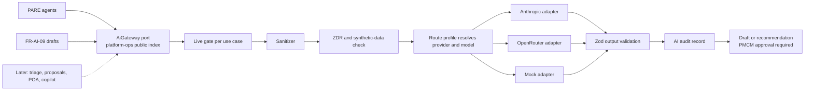

# Interchangeable AI provider gateway

## At a glance

- **Purpose:** Make every P.R.I.S.M AI use case independent of its provider. A
  use case declares what it needs; configuration decides which approved
  provider and model serve it, so Anthropic, OpenRouter, or a later provider
  can be swapped without changing feature code.
- **Authority:** Informative execution plan. The feature ledger, readiness
  foundation, and FR-AI-ZDR governance remain authoritative for product
  behavior. Durable decisions are promoted into an ADR in Phase 7, after which
  this plan is removed.
- **Owner:** D (Anthony) owns the gateway, the governance gate, and provider
  approval. B (Francis) co-owns the PARE and communication-draft workflows.
  A (Maxine) owns the draft review surface.
- **Scope:** Phases 0 to 7 below. Production live AI on real data is out of
  scope until D records the provider approval described in Phase 7.
- **Use/change:** Update when a phase closes, a Phase 0 check changes a
  decision, or a provider or model route is added or removed.
- **Verify with:** Each phase's exit check, the provider conformance suite,
  `npm run check:boundaries`, API tests, and proof that blocked paths make no
  network call.

## Goal

Interchangeable means four things:

1. Feature code calls `AiGateway.run` or `AiGateway.stream` with a use-case
   ID and a typed input. It never imports a provider SDK, names a model, or
   reads a provider key.
2. The active route profile chooses a route (provider, model, provider
   options) for each use case. Switching providers is a configuration change
   that is validated when the API starts.
3. A route may serve a use case only after it passes the same conformance
   suite as every other route for that use case.
4. Sanitizing, ZDR checks, limits, output validation, audit, and the PMCM
   approval rule run inside the gateway for every route, so adding a provider
   cannot bypass them.

## Current state

Verified at `0cbb9838`:

- Only PARE calls a model. `budget.agent.ts`, `risk.agent.ts`, and
  `message-drafter.agent.ts` each create
  `new Anthropic({ apiKey: process.env.ANTHROPIC_API_KEY })`, hardcode
  `claude-sonnet-4-6`, and carry their own copy of a six-turn tool loop.
- `pare-execution.policy.ts` rejects every mode except `mock`, so live PARE
  fails before any SDK import.
- `pare.service.ts` writes `OpsAiAuditLog` with `modelVersion: 'mock'` and
  `zdrConfirmed: true`, and infers live mode from
  `modelVersion === 'claude-sonnet-4-6'`. Any other model or provider would be
  reported as mock.
- When a live tool loop runs out of turns, all three agents return their mock
  result. In live mode that would present deterministic output as model output.
- `OpsAiAuditLog` has no columns for provider, route, prompt version, token
  usage, latency, or the basis of the ZDR claim.
- The API compiles to CommonJS (`module: commonjs`, `moduleResolution: node`).
  The root `package.json` requires Node `>=24`.
- The V4 catalog's FR-AI-ZDR entry assumes a ZDR agreement with Anthropic.
  P.R.I.S.M cannot obtain one, so the governance record must move to the new
  provider path before any real data reaches a model.

## Decisions

| Topic | Decision |
| --- | --- |
| Library | Vercel AI SDK v7 (`ai`, `@ai-sdk/anthropic`, `@openrouter/ai-sdk-provider`), pinned to exact versions, subject to the Phase 0 loading check. Fallback: keep the same port and implement it with `@anthropic-ai/sdk` (already a dependency) plus an OpenAI-compatible client for OpenRouter. Feature code is identical either way. |
| Placement | The `AiGateway` port lives in `platform-ops` contracts and is exported from `modules/platform-ops/index.ts`. Adapters live in `platform-ops/infrastructure/ai-governance`. Other contexts depend only on the port and supply their own tool handlers. |
| Configuration | The use-case registry and the route profiles are code, reviewed in PRs. Environment variables select a profile, hold keys, and list which use cases may go live. Everything is validated with Zod at startup. Invalid AI configuration fails startup only when a live use case is enabled; otherwise AI stays in mock and health reports it. |
| Production route | OpenRouter `z-ai/glm-5.3-flash` with ZDR required, provider endpoints pinned to verified ZDR slugs, and data collection denied. |
| Test route | Anthropic direct `claude-sonnet-4-6` on existing credits. It has no ZDR, so it accepts synthetic data only and is refused in production. |
| Failures | Fail closed. Retry the same route within limits. Never fail over to another provider or profile. Never substitute mock output in live mode. |
| Streaming | The port has `stream` from Phase 1. FR-AI-09 uses it in Phase 5. The input types leave room for multi-turn chat (FR-AI-05 POA, FR-AI-07 copilot), which is built later. |
| New use case | FR-AI-09 client communication drafts, starting with the unsigned-conforme trigger. |
| Done for this plan | Code complete; both routes pass the conformance suite; a staging pilot on synthetic data succeeds; production live AI stays off until D approves. |

## Architecture

### Use-case registry

Each use case is one registry entry:

| Field | Meaning |
| --- | --- |
| `id` | Stable ID such as `pare.budget`, `pare.risk`, `pare.message-drafts`, `comms.draft`. |
| `promptVersion` | Version of the system prompt and instructions; recorded on every call. |
| `input`, `output` | Zod schemas in `@prism/types`. Output that fails validation is a failure. |
| `tools` | Tool names with Zod input schemas; the owning context supplies handlers. |
| `modelTier` | `fast` or `strong`. Profiles map tiers to models, so a use case never names a model. |
| `dataClasses` | Data categories the use case may send after sanitizing. |
| `requiresZdr` | `true` for any use case that can receive real event data. |
| `approval` | Always `pmcm-required`. The gateway returns drafts and recommendations only. |
| `limits` | Maximum steps, output tokens, timeout, and daily token budget. |
| `delivery` | `run` or `stream`. |

### Route profiles

| Profile | Purpose | Routes | Data allowed |
| --- | --- | --- | --- |
| `mock` | Default, CI, and tests | Deterministic adapter; output labeled `mock` | Any |
| `test-anthropic` | Local and staging model testing | Both tiers to `anthropic:claude-sonnet-4-6` | Synthetic only; refused when `NODE_ENV=production` |
| `prod-openrouter-zdr` | Staging pilot, then production after approval | Both tiers to `openrouter:z-ai/glm-5.3-flash` at first; `strong` can move to another ZDR model without code changes | Sanitized real data, only after D's approval |

Environment variables:

| Variable | Meaning |
| --- | --- |
| `AI_ROUTE_PROFILE` | `mock` (default), `test-anthropic`, or `prod-openrouter-zdr`. |
| `AI_LIVE_USE_CASES` | Comma-separated use-case IDs allowed to call a provider. Empty by default. |
| `ANTHROPIC_API_KEY` | Anthropic key for `test-anthropic`. |
| `OPENROUTER_API_KEY` | OpenRouter key for `prod-openrouter-zdr`. |
| `PARE_MODE` | Kept as an alias during Phase 4 (`live` enables the `pare.*` use cases), then removed. |

Profiles are code, so adding a provider or model is a reviewed PR. The
environment can only choose among approved profiles.

### Data safety rules

1. The sanitizer runs before every provider call and its data categories are
   recorded.
2. Each route declares its ZDR basis: `provider-enforced` or `none`. A use
   case with `requiresZdr` can send real data only over a
   `provider-enforced` route.
3. A `none` route accepts only inputs the server can verify as synthetic
   (seeded sample events or test fixtures; the marker is defined in Phase 1),
   and is refused when `NODE_ENV=production`.
4. OpenRouter requests always send
   `provider: { zdr: true, data_collection: "deny", only: [<verified ZDR slugs>] }`.
   The OpenRouter account also enables its ZDR-only setting as a second guard.
5. Every call writes one audit record: use case, prompt version, profile,
   provider, requested model, model reported by the response, endpoint if
   reported, ZDR basis, data categories, token usage, latency, outcome, and
   approval state. Only the sanitized payload is stored, as today.
6. The gateway never sends, assigns, or changes records. Owning contexts act
   only after PMCM approval.

### Failure policy

- Each use case has a timeout. Abort signals pass through to the provider
  call, as PARE dispatch already does.
- Timeouts, 429 responses, and 5xx responses are retried on the same route up
  to twice with backoff. Validation and other 4xx errors are not retried.
- There is no failover to another provider or profile. Inside OpenRouter,
  fallback is limited to the pinned ZDR endpoints.
- After retries the result is `unavailable` with a reason. Portals show that
  the AI draft is unavailable and keep the manual path. PARE dispatch maps the
  result onto its existing retryable and terminal outcomes.
- A tool loop that runs out of steps is an `incomplete` failure. Mock output
  is never returned in live mode.

### Streaming

- `AiGateway.stream(useCase, input, signal)` yields text deltas and ends with
  the validated final result.
- The API streams from a POST endpoint in server-sent events format.
  `@prism/api-client` reads it with `fetch`, so request bodies and session
  headers work; `EventSource` is not used because it cannot send them.
- The audit record is written on completion, abort, or error. Aborted streams
  are recorded as `aborted` with the tokens used so far.

## Phases

| Phase | Work | Exit check |
| --- | --- | --- |
| 0. Go/no-go checks | (a) Load AI SDK v7 from the compiled CommonJS API on Node 24 through `require(esm)`, in Vitest, and in the Docker image. (b) List `z-ai/glm-5.3-flash` endpoints and record which support ZDR, tools, `tool_choice`, and structured output. (c) Send one synthetic forced-tool request per route: Anthropic Sonnet, and OpenRouter GLM pinned to ZDR endpoints. (d) Confirm the OpenRouter account ZDR setting and data terms. | Library decision recorded here. ZDR endpoint slugs recorded. If GLM has no ZDR endpoint with tool support, choose another ZDR model for `strong` before Phase 4. |
| 1. Contracts | Add `@prism/types` schemas for use-case IDs, route and profile config, the audit record, run and stream results, FR-AI-09 input and output, and PARE agent outputs (moved from `pare.types.ts`). Add the `AiGateway` port to `platform-ops` contracts. Define the synthetic-data marker. Add a boundary rule that allows `ai`, `@ai-sdk/*`, `@openrouter/*`, and `@anthropic-ai/sdk` only under `platform-ops/infrastructure/ai-governance`. | `@prism/types` build and tests pass. `check:boundaries` and `test:boundaries` pass, including a fixture that proves a forbidden provider import fails. |
| 2. Gateway core | Registry, profile resolution, per-use-case live gate (replaces `assertPareExecutionAllowed` and keeps its fail-before-network property), sanitizer, ZDR and synthetic checks, limits, retry and timeout, output validation, audit writer, and mock and fake adapters. | Tests show that a blocked use case, real data on a non-ZDR route, a non-ZDR route in production, a missing key, invalid output, an exhausted loop, and an abort each fail without a network call where required and write the expected audit outcome. |
| 3. Provider adapters | Anthropic and OpenRouter adapters with tool loops, OpenRouter provider options, usage and response-model extraction, and streaming. | Adapter tests against mocked HTTP verify base URL, key, model, and provider options per route. The conformance suite runs the same recorded fixtures through every adapter. |
| 4. PARE migration | Turn the three agents into use-case definitions and tool handlers and delete their copied loops. Replace the `PARE_MODE` gate with `AI_LIVE_USE_CASES`, keeping the alias for this phase. Derive live or mock from the stored run. Add a Prisma migration with nullable `provider`, `route_profile`, `prompt_version`, `response_model`, `zdr_basis`, `input_tokens`, `output_tokens`, `latency_ms`, and `outcome` columns on `trust_ops.ai_audit_logs`, following the migration ownership policy. | Existing PARE and dispatch tests pass. `prisma:validate`, `db:verify:offline`, and the migration guard pass. No provider SDK import exists outside the adapters. |
| 5. FR-AI-09 drafts | Add a PMCM "Generate draft" action for the unsigned-conforme trigger in `apps/event`, with a streaming review panel built as a feature slice. Place the draft workflow with notifications in `platform-ops` (FL-014), reading trigger state through `read-models`; confirm placement in Phase 1. Approved drafts enter the existing notification outbox as PMCM-authored messages; production delivery stays gated as today. Other catalog triggers and automatic scheduling come later. | Forbidden-role tests, no send without approval, mid-stream abort, and audit completeness pass. Event portal typecheck passes. Manual PMCM role path checked. |
| 6. Evaluation and pilot | Run a fixed synthetic scenario set for PARE and drafts on both routes. Measure tool-loop completion, schema pass rate, how often PMCM edits are needed, p50 and p95 latency, and cost per run. Then pilot `prod-openrouter-zdr` on staging with synthetic events only. | Results table added to this plan. Model chosen per tier. PARE stays on `strong` and may move to another ZDR model if Flash falls short. |
| 7. Governance promotion | Write an ADR for the AI gateway and provider interchangeability. Update FL-015, the readiness foundation, and the actual-system record with provider-neutral ZDR language that names the approved OpenRouter route and endpoints. Record D's approval: provider, model, endpoints, ZDR basis, data classes, and a Philippine Data Privacy Act check of the new data path. Promote durable content and remove this plan. | D's approval recorded. Production `AI_LIVE_USE_CASES` stays empty until then. |

## Risks and open questions

| Risk or question | Handling |
| --- | --- |
| GLM 5.3 Flash may not complete PARE tool loops reliably. | Phase 6 measures it; `strong` can move to another ZDR model through configuration. |
| GLM ZDR endpoints may lack tool support. | Phase 0 go/no-go before any migration work depends on it. |
| AI SDK v7 is ESM-only and the API is CommonJS. | Phase 0 tests Node 24 `require(esm)`; otherwise use the fallback adapters behind the same port. |
| OpenRouter and the model host become data processors. | ZDR per request plus the account setting; list both processors and their hosting location in privacy documentation during Phase 7. |
| Test route has no ZDR. | Synthetic-only rule enforced in code and refused in production. |
| SDK and provider API changes. | Exact version pins; only adapters import provider packages; the conformance suite catches behavior changes. |
| Cost growth as use cases are added. | Daily token budgets per use case, usage recorded in audit, and OpenRouter credit alerts. |
